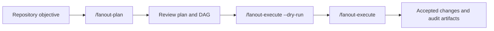

# Fanout

Fanout is a Pi extension that turns a reviewed repository objective into bounded, dependency-aware work. It prepares a human-reviewable execution packet, runs eligible work in isolated Git worktrees, validates exact patches, and preserves an auditable chain from planning authority to accepted repository state.

The monorepo also contains an independently installable [Doubleword provider](packages/doubleword-provider/README.md) for realtime and async inference in Pi.

> **Status:** Fanout planning and execution are implemented on `main` and pass the offline/keyless acceptance suite. Fanout remains an experimental local release candidate: the live macOS canary and repository-owner approval are still release gates. The standalone Doubleword provider is published separately.

## Why Fanout?

Coding work mixes two different kinds of activity:

- interactive judgment—planning, clarification, review, repair, and synthesis—where fast feedback matters;
- bounded implementation—changes that may be independent enough to run concurrently or through slower async inference.

Putting every turn into a slower async tier makes an interactive workflow wait. Launching parallel workers without explicit contracts creates a different problem: unclear file authority, hidden dependencies, conflicting edits, uncertain validation, and no proof that the patch being applied is the patch that passed validation.

Fanout separates model judgment from deterministic repository authority:

1. Models propose and ground the work.
2. Core code compiles typed work contracts, dependency edges, routing, and validation into an immutable Execution Packet.
3. The user reviews the plan and DAG before repository mutation.
4. The executor runs only dependency-ready work, validates exact candidate patches, and integrates accepted transitions in order.
5. A final reconstruction validates the complete Accepted Ledger and an event log records what happened.

### How the DAG helps

The DAG is more than a diagram. Fanout derives it from typed repository reads and writes:

- independent nodes can run concurrently, up to the packet's concurrency limit;
- a node that needs another node's accepted change waits for that prerequisite;
- baseline-only reads do not create unnecessary serialization;
- cycles, conflicting ownership, unresolved read/write overlap, and missing validation are rejected during compilation;
- `execution-dag.mmd` makes the resulting order and parallel width reviewable before execution.

This lets Fanout expose useful parallelism without treating every planned task as safe to run at the same time.

### How the tiers help

Fanout has **two execution tiers and three model roles**:

| Role | Purpose |
| --- | --- |
| **Tier 1** | Pi's active realtime model for planning, review, controller work, typed repair, and final validation. |
| **Tier 2** | An eligible async/background model for bounded worker nodes whose latency can be tolerated or overlapped. |
| **Tier 2 fallback** | A concrete realtime worker model used when permitted Tier 2 work exhausts its retry path; this is a role, not a third tier. |

The benefit is deliberate workload placement: keep judgment-heavy interaction responsive while allowing independent execution work to use async inference when its wait can be hidden behind parallel progress. If Tier 2 is disabled or unavailable, newly planned eligible nodes use the configured realtime fallback instead.

Tier selection does **not** guarantee a speedup or cost reduction. Results depend on the objective, DAG width, provider behavior, and how much async latency the workflow can actually hide. Tier 2 is asynchronous at the provider level; `/fanout-execute` still waits for the run and is not a detached job system.

## How it works



1. **Configure roles** with `/fanout-config`. Tier 1 follows the active Pi model; Tier 2 and its realtime fallback are selected separately.
2. **Prepare a packet** with `/fanout-plan [objective]`. Two read-only model phases create the semantic plan and repository grounding; `fanout-core` deterministically compiles the Work Contracts, DAG, routing, validation, and final-validation node.
3. **Review the output** in `execution-plan.md` and `execution-dag.mmd`. Planning writes artifacts to Pi-owned storage and does not mutate project files.
4. **Run preflight** with `/fanout-execute --dry-run`. It verifies packet identity, repository commit/tree/platform, commands, worker capability, artifact placement, and execution locking without launching workers or provider calls.
5. **Execute the accepted packet** with `/fanout-execute`. Ready nodes run in isolated reconstructions, and accepted patches pass typed authority, declared validation, and exact Git tree checks before integration.
6. **Inspect the result** through the terminal summary and execution artifacts. `events.jsonl` is the authoritative run history; projections and Markdown summaries are derived views.

## Repository packages

| Package | Responsibility | Distribution |
| --- | --- | --- |
| [`fanout-core`](packages/fanout-core) | Pi-independent contracts, validation, DAG derivation, routing policy, event reduction, and deterministic reports. | Internal workspace package |
| [`fanout-pi`](packages/fanout-pi) | Pi commands, planning, worker execution, Git integration, validation, and presentation. | Local experimental extension |
| [`doubleword-provider`](packages/doubleword-provider) | Standalone Doubleword model discovery, realtime/async transport, tool use, and provider observability. | Published Pi package |

`fanout-core` imports neither Pi nor Doubleword. The current product adapter is `fanout-pi`; the standalone provider has no Fanout dependency.

## Local quick start

The root Fanout package is private and currently loaded from source. From this prepared checkout:

```bash
pi -e .
```

To use the extension against another repository, start Pi from that repository and provide the extension's absolute path:

```bash
cd /path/to/target-repository
pi -e /path/to/fanout/packages/fanout-pi/src/index.ts
```

Then run the workflow inside Pi:

```text
/fanout-config
/fanout-plan Add the requested repository change
/fanout-execute --dry-run
/fanout-execute
```

Use a clean Git checkout that Fanout can reconstruct exactly. Review the generated plan and DAG before execution. Dependencies needed inside disposable worktrees must already be available through the repository or explicitly shared as prepared, ignored top-level paths; Fanout does not install dependencies in those worktrees.

Planning artifacts are stored outside the repository by default:

```text
~/.pi/agent/fanout/<project-id>/<run-id>/
  implementation-plan.json
  implementation-details.json
  execution-packet.json
  execution-plan.md
  execution-dag.mmd
```

Execution adds an `executions/<execution-run-id>/` directory containing the authoritative event log, derived summary, per-attempt evidence, accepted patches, and final-validation evidence.

## Common configuration

| Control | Effect |
| --- | --- |
| `/fanout-config` | Shows the artifact root and configures Tier 1, Tier 2, and the realtime Tier 2 fallback. |
| `FANOUT_ARTIFACT_DIR` | Overrides the Pi-owned artifact root for the current process. |
| `fanout.artifactDir` | Sets a persistent artifact root in Pi settings. |
| `fanout.execution.maxConcurrency` | Sets the maximum parallel node count used by newly planned packets; the default is `2`. The value is frozen into the packet. |
| `FANOUT_WORKTREE_SHARED_PATHS` | JSON array of existing, unique, Git-ignored, top-level paths to link into disposable worktrees, for example `["node_modules"]`. |

Routing details and eligibility rules are documented in [Tier and model resolution](docs/TIER_MODEL_RESOLUTION.md). Worktree preparation and its trust implications are documented in [Architecture](docs/ARCHITECTURE.md#worktree-preparation).

## Standalone Doubleword provider

Install the independently published provider without Fanout:

```bash
pi install npm:@snehalyelmati/pi-doubleword-provider
```

Start Pi with a live Doubleword model:

```bash
export DOUBLEWORD_API_KEY=...
pi --model doubleword/deepseek-ai/DeepSeek-V4-Flash
```

Use `Alt+T` or `/doubleword-mode` to toggle realtime and async execution. See the [provider README](packages/doubleword-provider/README.md) for configuration, capabilities, and limitations.

Pi package page: <https://pi.dev/packages/@snehalyelmati/pi-doubleword-provider>

## Guarantees and limitations

### Fanout provides

- an immutable Execution Packet bound to the planning commit, Git-visible tree, platform, and source artifacts;
- typed write authority, read dependencies, forbidden writes, and declared validation for every Work Contract;
- deterministic DAG derivation and bounded dependency-aware scheduling;
- fresh detached Git worktrees for worker attempts and integrated final validation;
- exact binary patch, changed-path, base-tree, and result-tree verification before accepted integration;
- fixed controller-owned retry, fallback, and repair budgets;
- an append-only event log plus per-attempt and final-validation evidence.

### Fanout does not provide

- an OS, process, credential, network, provider, extension, or command sandbox;
- automatic rollback of earlier accepted transitions when later work or final validation fails;
- automatic dependency installation in reconstructed worktrees;
- guaranteed latency, throughput, or provider-cost improvements;
- a detached background-job UX or interactive batch-inference tier;
- generic support for every coding agent—the implemented adapter is currently Pi.

Trusted Pi code, repository instructions, providers, extensions, approved programs, inherited environment, ignored files, external paths, network access, and child processes retain the user's host permissions. See the [architecture trust boundary](docs/ARCHITECTURE.md#trust-boundary) for details.

## Development and validation

From a prepared repository checkout:

```bash
npm run check
npm run test:doubleword-provider
npm run smoke:benchmarks
```

- `npm run check` runs the keyless planning and execution acceptance matrix.
- `npm run test:doubleword-provider` validates the standalone provider with local mocks.
- `npm run smoke:benchmarks` validates the offline benchmark fixtures and summarizer.

## Evidence and release status

The hardened planning and execution generation is implemented on `main` and passes the documented offline/keyless checks. Those checks establish deterministic contract, repository-boundary, routing, patch, validation, event, and cleanup behavior; they do not establish live provider readiness or a general performance improvement.

Live release remains gated on the explicitly authorized macOS p-map canary, inspection of its evidence, fresh review, and repository-owner approval of the same immutable candidate. Benchmark documents distinguish observed, retrospective, synthetic, and canary evidence so that workflow gains are not conflated with provider-tier savings.

## Documentation map

| Document | Use it for |
| --- | --- |
| [`CONTEXT.md`](CONTEXT.md) | Canonical Fanout domain language and definitions. |
| [`docs/ARCHITECTURE.md`](docs/ARCHITECTURE.md) | Package boundaries, authority flow, execution architecture, and trust model. |
| [`docs/TIER_MODEL_RESOLUTION.md`](docs/TIER_MODEL_RESOLUTION.md) | Tier roles, model eligibility, fallback behavior, and immutable routing policy. |
| [`docs/impl/phase-2b-fanout-plan.md`](docs/impl/phase-2b-fanout-plan.md) | Planning artifacts, compiler boundaries, and packet acceptance. |
| [`docs/impl/phase-3-fanout-execute.md`](docs/impl/phase-3-fanout-execute.md) | Execution contracts, offline acceptance matrix, and live release gates. |
| [`docs/BENCHMARKS.md`](docs/BENCHMARKS.md) | Benchmark methodology, evidence categories, results, and limitations. |
| [`docs/DESIGN_DECISIONS.md`](docs/DESIGN_DECISIONS.md) | Chronological project decisions and revisions. |
| [`docs/ROADMAP.md`](docs/ROADMAP.md) | Current implementation status, pending gates, and deferred work. |
| [`packages/doubleword-provider/README.md`](packages/doubleword-provider/README.md) | Standalone provider installation, configuration, and usage. |
