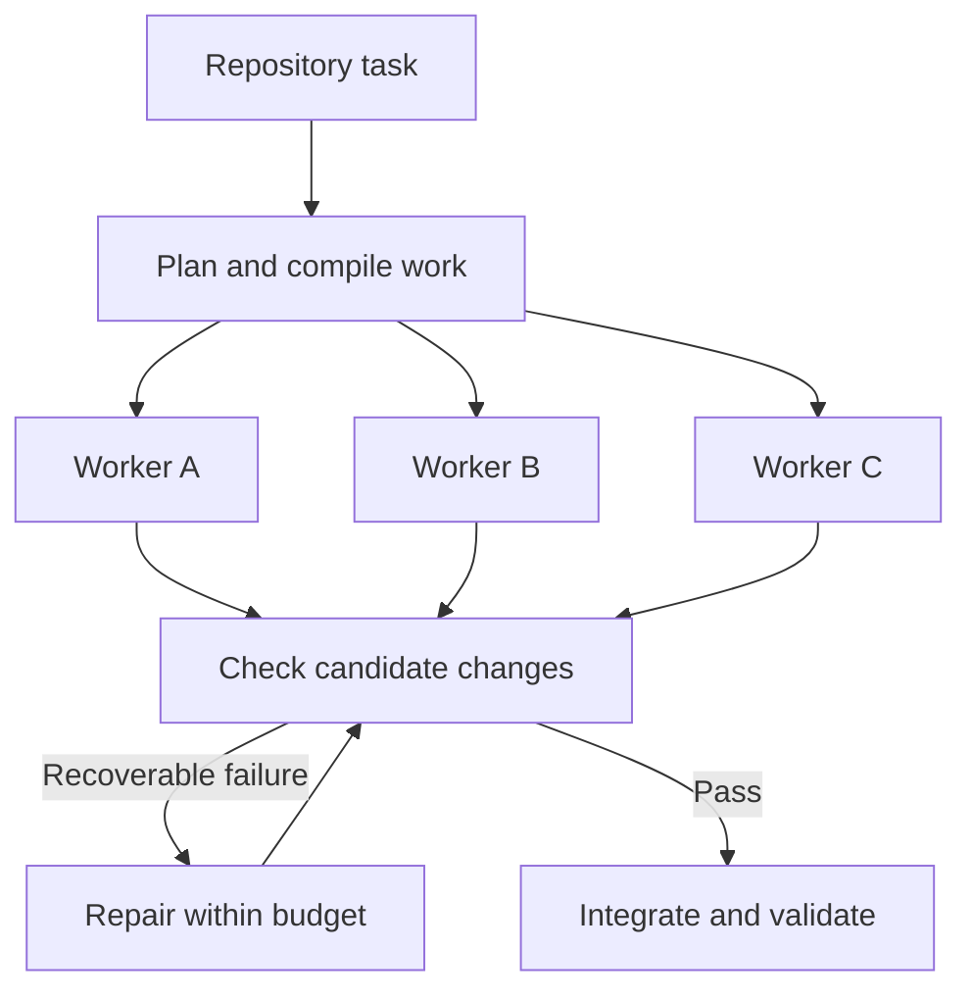

# Fanout — Research Preview

**A parallel coding-agent harness for exploring high-latency, low-cost inference.**

Fanout pairs a capable coordinator with parallel coding workers. Built on Pi, a coding agent, it turns repository tasks into reviewable work plans, runs workers in isolated Git worktrees, and validates their changes before integration. Planning, execution and repair are recorded so you can investigate where time and money go.

[Read the study](docs/STUDY.md) · [Run from source](docs/GETTING_STARTED.md) · [Explore the architecture](docs/ARCHITECTURE.md) · [Results and figures](docs/study/README.md)

## Why Fanout?

Slower inference can become useful when enough independent work runs together. A capable coordinator can establish scope and dependencies, while less expensive workers execute in parallel. Better worker quality and fewer sequential requests leave more room for coordination and repair.

Fanout gives that idea a working implementation and an experimental foundation: a Pi integration, an independent Doubleword provider, a local execution profiler, and a study of the conditions under which the tradeoff can work.

## How Fanout works



Models propose the work; the controller compiles dependencies, enforces write boundaries and integrates validated changes. Actual dependencies determine concurrency. Coordinator and worker models can differ, each worker keeps Pi's normal iterative loop, and fixed retry and repair budgets keep recovery bounded.

## Problems that shaped Fanout

The coding benchmarks use feature tasks in real open-source projects. [p-map](https://github.com/sindresorhus/p-map) is a JavaScript library for running asynchronous work concurrently; [Execa](https://github.com/sindresorhus/execa) runs external commands from Node.js. These are projects the agents worked on.

**A convincing plan can still be impossible to execute.** An early evaluation accepted individual work units whose combined dependencies formed a cycle. Models describe changes and required inputs; a deterministic compiler constructs and checks the execution graph before workers launch. [Why the compiler owns scheduling](docs/STUDY.md#architecture-and-comparison-framework).

**Workers need tasks they can repair.** Splitting implementation and tests looked parallel, but left a test worker able to detect a defect it had no permission to fix. Fanout groups tightly coupled code and tests under one owner, while independently authorable work can proceed concurrently. [How task boundaries evolved](docs/STUDY.md#decompose-around-repair-ownership).

**Some model failures were formatting problems.** Two early p-map runs exhausted their final repairs on formatting. An offline reconstruction passed all 55 tests after one formatter run. Repository profiles now declare normalization steps that run before validation, leaving model repair for remaining failures. [The normalization decision](docs/DESIGN_DECISIONS.md#normalize-candidates-only-through-packet-declared-commands).

**Failed attempts can contain progress worth keeping.** Rebuilding repairs from accepted code discarded earlier corrections. Fanout now carries verified changes that failed validation into the next repair, keeping them separate from accepted changes until a candidate passes the required checks. [How repair continuity works](docs/DESIGN_DECISIONS.md#preserve-rejected-repair-candidates-cumulatively).

Other lessons include [sharing planning context](docs/STUDY.md#separate-artifact-structure-from-model-context) and [displaying reports without feeding them back to the model](docs/research/pi-report-context-boundary.md).

## Explore the study

The study follows the investigation from ordinary agent workflows to working parallel execution. Five fixed-configuration [Execa runs](docs/STUDY.md#historical-parallel-execution-execa) completed with worker overlap and validated integration. Further experiments explored planning overhead, worker request depth, repair costs and provider latency.

**Parallel Fanout is the primary architecture.** Whole-task candidate submission is a separate experiment in reducing sequential requests. The report brings both together with curated results, static figures and a model of favorable operating conditions.

This is a research preview: measured outcomes apply to their tested configurations, and the matched realtime/async coding comparison remains open. The [study](docs/STUDY.md) documents the evidence and limits; the [methodology](docs/study/METHODOLOGY.md) explains reproducibility and new experiments. Raw execution traces stay local.

## Try Fanout

Follow the [source setup guide](docs/GETTING_STARTED.md), which includes an offline check requiring no Doubleword account. After loading the extension in Pi:

```text
/fanout-config
/fanout-plan Implement the repository objective
/fanout-execute --dry-run
/fanout-execute
```

Start with a clean target Git repository. Planning creates reviewable artifacts; live execution asks for confirmation. Repository profiles declare trusted preparation, normalization and validation commands. Even dry-run preflight can invoke approved profile commands; review the profile before running it.

## Packages

| Package | Responsibility |
| --- | --- |
| `fanout-core` | Agent-independent contracts, compilation, scheduling, validation policy and evidence |
| `fanout-pi` | Pi planning and execution adapter; keeps provider support separate from core |
| `doubleword-provider` | Standalone Pi provider for Doubleword realtime and async inference, with offline stubs |
| `fanout-profiler` | Local, read-only run inspection and scheduling scenarios with recorded work held fixed |

Run Fanout from source. The Doubleword provider is also available as a [separate install](packages/doubleword-provider/README.md). The profiler runs locally and reads your execution artifacts.

## Explore further

- [Architecture](docs/ARCHITECTURE.md): package boundaries, work contracts and execution.
- [Design history](docs/DESIGN_DECISIONS.md): problems, decisions and revisions.
- [Runtime guide](docs/FANOUT_GUIDE.md): commands, validation and the local profiler.
- [Roadmap](docs/ROADMAP.md): implementation status and open questions.

## License

Fanout's original code and documentation are available under the [MIT license](LICENSE). Dependencies and third-party materials retain their own licenses and notices; see [third-party notices](THIRD_PARTY_NOTICES.md).
