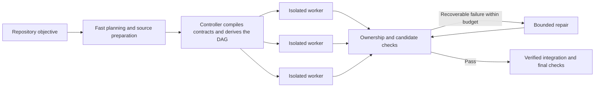

# Fanout — Research Preview

Fanout is an experimental parallel coding-agent harness for high-latency, low-cost inference. Models propose work; deterministic contracts govern scheduling, ownership, validation and bounded repair. Isolated workers produce candidates that the controller checks and integrates.

**When can parallel execution make inexpensive, slower inference competitive with an ordinary realtime coding agent?** This repository contains the working Pi integration, a standalone Doubleword provider, a local execution profiler, and a study of the conditions that determine completion time and cost.

- [Read the study](docs/STUDY.md): findings, experiment families, static figures and limitations.
- [Try Fanout from source](docs/GETTING_STARTED.md): setup, offline checks and Pi commands.
- [Inspect the curated results](docs/study/README.md): per-run summaries and figure reproduction.
- [Use the Doubleword provider independently](packages/doubleword-provider/README.md).

## What the study finds

Earlier [Execa parallel-execution trials](docs/STUDY.md#historical-parallel-execution-execa) completed five fixed-packet runs with observed worker overlap and deterministic integration. Those historical execution results demonstrate the mechanism; full task savings depend on planning, validation and recovery. The [engineering lessons](docs/STUDY.md#lessons-from-building-the-harness) explain how repair ownership, validation scope and preserving repair progress shape that tradeoff.

Parallel execution can overlap request latency and amortize coordination when there is enough independent work. Its modeled winning region depends on useful width, sequential requests, worker throughput, prices and repair overhead. Parallelism alone does not reduce total token cost.

Experiments identified concrete bottlenecks: repeated planning, long worker request chains, validation scope and expensive repairs. Combined planning and prepared source context reduced overhead in the p-map pilot, but did not establish a reliable advantage over ordinary Pi. Complete-candidate experiments explore reducing request depth, both inside Fanout and in a separate whole-task experiment. The whole-task variant produced positive p-map and qs observations and failed quality/cost comparisons on a larger shared-contract task.

These are useful constraints on the architecture. Which task/model/provider combinations repeatedly deliver correct completion at lower cost and comparable time remains an empirical question. The [report](docs/STUDY.md) separates measured results, fixed-trace counterfactuals and hypothetical provider designs. This preview does not claim a completed successful async-versus-realtime coding benchmark or a production reliability guarantee.

## How Fanout works



Concurrency follows actual dependencies and repair authority. Each worker can use Pi's normal iterative loop; complete-candidate delivery is an independent experimental dimension. Runtime code and its tightly coupled tests usually need one repair owner. Separate coordinator and worker model roles support different capability/cost choices, while the packet freezes each run's assignments.

In a configured Pi session:

```text
/fanout-config
/fanout-plan Implement the repository objective
/fanout-execute --dry-run
/fanout-execute
```

Start with a clean target Git repository. Planning creates reviewable artifacts; execution asks for confirmation. Repository profiles declare preparation, normalization and validation commands. These are trusted local programs, and even dry-run preflight can invoke approved profile commands. See the [setup guide](docs/GETTING_STARTED.md) and [runtime guide](docs/FANOUT_GUIDE.md) before a live run.

## Packages

| Package | Responsibility |
| --- | --- |
| `doubleword-provider` | Standalone Pi provider for Doubleword realtime and async inference, with offline stubs |
| `fanout-core` | Agent-independent contracts, compilation, scheduling, validation policy and evidence |
| `fanout-pi` | Pi planning and execution adapter; keeps provider support separate from core |
| `fanout-profiler` | Local, read-only evidence inspection, comparisons and fixed-behavior scheduling scenarios |

The Fanout workspaces are source-only and marked private for package publishing. The provider has its own [installation and configuration guide](packages/doubleword-provider/README.md). The existing profiler is a local engineering tool; this research release presents static figures and does not host an explorer or upload run artifacts.

## Evidence and reproducibility

The current research materials contain curated per-run metrics, methodology, static figures and synthetic test fixtures. New raw Fanout traces, model sessions, prompts and tool-event streams stay local and are excluded from tracked research assets. Historical measurements cannot be independently replayed from summaries alone. Figure arithmetic is reproducible from the published inputs; rerunning a model workflow is a new experiment. See [data provenance and limitations](docs/study/README.md) and the [publication checklist](docs/PUBLICATION.md).

## Project documentation

Current implementation references:

- [Architecture](docs/ARCHITECTURE.md) and [domain glossary](CONTEXT.md)
- Accepted decisions: [local trust](docs/adr/0001-inherit-pi-local-trust.md), [execution authority](docs/adr/0002-use-one-strict-execution-authority.md), [attempts and measurements](docs/adr/0005-route-attempts-from-typed-facts-and-fixed-budgets.md), and [normalization](docs/adr/0006-normalize-candidates-before-capture.md)
- [Workflow and local profiler](docs/FANOUT_GUIDE.md)
- [Planning contracts](docs/impl/phase-2b-fanout-plan.md) and [execution contracts and checks](docs/impl/phase-3-fanout-execute.md)
- [Roadmap](docs/ROADMAP.md)

Research and decision history:

- [Research methods and historical protocol](docs/benchmarks/fanout-high-latency-study.md)
- [Benchmark ledger](docs/BENCHMARKS.md)
- [Dated design decisions](docs/DESIGN_DECISIONS.md)

## License

Fanout's original code and documentation are available under the [MIT license](LICENSE). Dependencies and third-party materials retain their own licenses and notices; see [third-party notices](THIRD_PARTY_NOTICES.md).
