# Fanout Architecture

Fanout has one planning-to-execution path. The architecture separates semantic model judgment from deterministic repository authority, then preserves exact evidence for every state transition.

## Package boundaries

| Package | Responsibility |
| --- | --- |
| `fanout-core` | Pi-independent schemas, validators, compiler, resource and graph derivation, routing policy, event reducer, projection, and deterministic report model |
| `fanout-pi` | Pi commands and capabilities, artifact publication, worker processes, Git worktrees, normalization, validation, event recording, and context-free presentation |
| `doubleword-provider` | Standalone Doubleword provider, model discovery, transport, and provider observability; it has no Fanout dependency |
| `fanout-profiler` | Private read-only catalog, workspace queries, comparisons, diagnostics, fixed-behavior scenarios, and loopback HTTP presentation; it depends only on `fanout-core` |

`fanout-core` imports neither Pi nor Doubleword. `fanout-pi` adapts both Pi and provider evidence into core contracts rather than defining a second execution model. The standalone provider exposes no Fanout fields; the Pi runtime adapter projects remembered Doubleword models into the `model.fanout` registry shape used for routing.

## Current contract generation

| Authority | Schema | Version |
| --- | --- | ---: |
| Project Execution Profile | `fanout.project-execution-profile` | 1 |
| Active profile pointer | `fanout.active-project-execution-profile` | 1 |
| Plan | `fanout.implementation-plan` | 3 |
| Grounding | `fanout.implementation-details` | 5 |
| Execution packet | `fanout.execution-packet` | 7 |
| Active packet pointer | `fanout.active-packet` | 2 |
| Work contract | `fanout.work-contract` | 3 |
| Attempt outcome | `fanout.attempt-outcome` | 4 |
| Final-validation evidence | `fanout.final-validation-evidence` | 2 |
| Run event | `fanout.execution-event` | 4 |
| Execution projection | `fanout.execution-run` | 5 |
| Planning/execution presentation data | `fanout.planning-report` / `fanout.execution-report` | 1 |

These versions form one closed executable generation. Older planning authority requires replanning; older execution evidence is Legacy descriptive data only and is not migrated, replayed as current, or mixed with this generation.

## Authority flow

```mermaid
flowchart LR
    U["User objective"] --> A["Phase A: plan body"]
    A --> P["Controller-bound plan v3"]
    P --> B["Phase B: grounding body"]
    B --> D["Controller-bound details v5"]
    E["Approved execution profile v1"] --> C
    D --> C["Core compiler"]
    C --> K["Packet v7 with work-contract v3 nodes"]
    K --> X["Exact active pointer"]
    X --> F["Preflight and user confirmation"]
    F --> W["Isolated preparation, then DAG worker attempts"]
    W --> N["Candidate normalization"]
    N --> G["Patch capture, ownership, validation"]
    G --> L["Accepted-state ledger and active apply"]
    L --> V["Fresh reconstructed final validation"]
    V --> R["Terminal run result"]
```

### Planning

Starting a planning run invalidates the previous active packet pointer; if planning fails, no stale packet remains selected. The controller captures the planning commit, full Git-visible tree, platform, run identity, and exact active Project Execution Profile identity. `/fanout-plan --refresh-profile` first gathers and validates a replacement profile in a disposable clean worktree, publishing its pointer only after success; a failed refresh preserves the prior profile. Phase A and Phase B submit only their assigned bodies through a controller-bound tool; models cannot choose artifact destinations or envelope identities. Phase A groups production and behavioral-test writes by independent acceptability and repairability rather than file category, and split items declare only genuine typed reads. The compiler validates same-source scope, derives ownership groups and DAG edges from typed resources, fuses only eligible vertical serial chains, inserts fixed worker capabilities, creates the final-validation node, and publishes packet-derived human views before selecting packet v7 through pointer v2.

Each planning phase is a typed pending controller state. Its full instructions are injected for one turn through `before_agent_start.systemPrompt`, while the visible user message is only a short trigger. This internal prompt path is separate from the context-free custom entries used to present completed planning and execution reports.

Relevant code: [`fanout-planning-controller.ts`](../packages/fanout-pi/src/fanout-planning-controller.ts), [`fanout-runtime-context.ts`](../packages/fanout-pi/src/fanout-runtime-context.ts), [`planning-capabilities.ts`](../packages/fanout-pi/src/planning-capabilities.ts), [`fanout-compiler.ts`](../packages/fanout-core/src/fanout-compiler.ts), [`work-contract-compiler.ts`](../packages/fanout-core/src/work-contract-compiler.ts), and [`execution-packet.ts`](../packages/fanout-core/src/execution-packet.ts).

### Execution

Execution verifies the active packet pointer, packet bytes, and the packet-bound profile bytes before repository mutation, then acquires the repository lock. Refreshing the orthogonal active profile pointer does not invalidate an existing packet: execution loads the packet's exact profile identity. The profile is validated in a disposable clean worktree before confirmation or paid model allocation. Preflight requires the planning tree to equal the packet's committed HEAD tree and current checkout, resolves the worker launcher and extension, verifies fixed tool capabilities, and checks profile normalization/final-gate plus packet task-validation argv. The closed results and exact profile-validation artifact are referenced by `run-started`; inherited environment values and credentials are never copied into it.

Each allocated attempt runs Pi in a fresh detached reconstruction with six model-callable file tools after that worktree independently passes profile preparation and readiness. The worker ends its existing response with a numbered `Worker summary`; the adapter stores the extracted final summary in `result.json` and supplies it only to the immediately following node validation-repair prompt. The summary is optional diagnostic context and never routing, recovery, validation, repair-state, or acceptance authority. Acceptance requires complete correlated usage, pricing, turn, tool, and local worker-timing evidence. Generic providers use worker-first-output timing and must not claim provider response or poll records; instrumented Doubleword attempts additionally require correlated response TTFT and polling evidence. Failed attempts preserve the partial evidence actually observed. After a successful edit, the controller runs profile normalization, captures its binary patch, enforces typed ownership and forbidden writes, runs packet task validation, reverifies the candidate, and applies verified bytes through Git stdin under exact tree checks.

Accepted attempts require Attempt Outcome v4 evidence with exact Worker Turn request/first-output/finish intervals, Provider Response request/first-token/finish intervals when instrumented, named Tool Invocation intervals, cache usage, controller disposition, and exact repair-state progress when applicable. Accepted attempts append one transition to the event-reduced ledger and mutate active incrementally. A rejected candidate seeds the immediately following repair, including across process-only failures, but never enters the ledger. Exact repeated candidate/failure state stops without spending remaining repair budget.

If a parallel candidate is stale, the controller first tries exact path-disjoint reconciliation: reconstruct the latest ledger, overlay, normalize, recapture, enforce ownership, validate, and compare-and-swap apply. Only ledger advancement permits a retry. Unavailable base, overlap, invalid overlay, normalization failure, ownership failure, or combined-validation failure routes through typed integration repair; preparation and repository infrastructure failures fail closed without consuming repair budget. Final validation runs packet final commands followed by profile-required final gates in another independently prepared reconstruction; only typed program failures may launch bounded final repairs. A final repair derives its effective command contract from that same ordered combined manifest, so packet and profile gates remain identical between failure evidence, repair prompting, and revalidation.

Relevant code: [`fanout-execute.ts`](../packages/fanout-pi/src/fanout-execute.ts), [`fanout-node-executor.ts`](../packages/fanout-pi/src/fanout-node-executor.ts), [`worker-attempt-execution.ts`](../packages/fanout-pi/src/worker-attempt-execution.ts), [`candidate-reconciliation.ts`](../packages/fanout-pi/src/candidate-reconciliation.ts), [`project-execution-profile.ts`](../packages/fanout-pi/src/project-execution-profile.ts), [`repository-identity.ts`](../packages/fanout-pi/src/repository-identity.ts), [`final-validation-adapter.ts`](../packages/fanout-pi/src/final-validation-adapter.ts), and [`final-validation.ts`](../packages/fanout-pi/src/final-validation.ts).

### Worktree preparation

The user-approved Project Execution Profile supplies ordered direct-argv preparation and readiness commands for every disposable profile-validation, worker, repair, reconciliation, and final-validation worktree. Commands disclose purpose, expected mutation, network use, and lifecycle-script authority. `candidate-owned` is available only to candidate-normalization declarations and grants no write authority beyond the work contract; clean-baseline profile validation must still remain unchanged. Preparation must leave `HEAD`, index relation, and the Git-visible tree unchanged; failure occurs before model allocation and consumes no worker or repair budget.

`FANOUT_WORKTREE_SHARED_PATHS` is rejected. Fanout does not add shared, copied, COW, or cached dependency behavior; package managers may use their native global caches. Profile identity and per-worktree preparation/readiness evidence remain separate from packet task authority.

Relevant code: [`worktree-preparation.ts`](../packages/fanout-pi/src/worktree-preparation.ts), [`fanout-execute.ts`](../packages/fanout-pi/src/fanout-execute.ts), [`fanout-node-executor.ts`](../packages/fanout-pi/src/fanout-node-executor.ts), and [`final-validation.ts`](../packages/fanout-pi/src/final-validation.ts).

### Audit and presentation

Attempt allocation and final-validation start events are recorded before their dependent execution. Accepted apply is the deliberate exception: Git mutates active first, then Fanout records the completed outcome and accepted transition. If that post-mutation bookkeeping fails, the run fails hard, retains its lock, and requires manual reconciliation rather than claiming the event log already represents active state.

The pure core reducer produces projection v5 from the otherwise gapless event-v4 log; `execution-run.json` and terminal `summary.md` are replaceable derived views. Worktree cleanup runs once before `run-finished`, whose duration includes cleanup and records cleanup timing; cleanup failure produces a failed terminal event rather than a false completed outcome. Audit replay can regenerate views but has no execution or Git authority; replaying a nonterminal log removes any stale summary.

Relevant code: [`execution-event.ts`](../packages/fanout-core/src/execution-event.ts), [`execution-projection.ts`](../packages/fanout-core/src/execution-projection.ts), [`execution-event-store.ts`](../packages/fanout-pi/src/execution-event-store.ts), and [`report-presentation.ts`](../packages/fanout-pi/src/report-presentation.ts).

### Offline profiler catalog and authority

The repository profiler launcher resolves the current working directory through Fanout's Pi-owned artifact settings and passes one storage root plus the current project identity to the private `fanout-profiler` process; an explicit artifact root retains single-project forensic mode. The identity is `<basename>-<hash>`, where `hash` is the first 12 hexadecimal characters of SHA-1 over the resolved absolute working-directory path, so clones and worktrees remain distinct. The profiler package stays independent from Pi and fixes the supplied canonical root for its lifetime. Its project registry admits only immediate non-symlink child directories containing recognized planning, packet, pointer, or execution evidence, exposes opaque project identities rather than filesystem paths, and scopes every catalog request and Source Reference to one selected project. Runtime-context or observability-only directories do not enter the picker. A manual refresh serially rescans project membership and refreshes the selected immutable catalog before swapping registry state. Existing requests may finish against captured snapshots, root-level refresh failure preserves the prior registry and catalog, and run selection falls back only when the prior identity disappeared.

The Event Log is still the sole execution-state authority. Current Event v4 logs replay through `fanout-core`; projections and reports are ignored when a valid log exists, while Legacy, Invalid, and Unverifiable evidence remains explicitly labelled. Evidence Receipts, exact cohorts, pair comparisons, and cross-packet node alignment include exact profile identity; existing inspector fields surface reconciliation and no-progress dispositions. Scenario scheduling uses the post-confirmation Event boundary. Total run duration may be greater because its clock starts before profile validation and `run-started`; it must never be shorter than the Event-log span. No new profiler route, page, export, dashboard, or benchmark feature is introduced.

The Bun HTTP adapter binds to `127.0.0.1` and exposes only the fixed same-origin catalog, workspace, evidence, comparison, diagnostics, scenario, and refresh operations. Browser code renders server-produced views; it does not read files, admit contracts, replay events, or simulate schedules.

Relevant code: [`project-registry.ts`](../packages/fanout-profiler/src/project-registry.ts), [`catalog.ts`](../packages/fanout-profiler/src/catalog.ts), [`catalog-source.ts`](../packages/fanout-profiler/src/catalog-source.ts), and [`server.ts`](../packages/fanout-profiler/src/server.ts).

### Offline profiler scenarios

The profiler admits current Event Logs through `fanout-core` and exposes a user-invoked, read-only scenario query. Observed, sequential, custom positive-safe-integer, and unlimited Fanout concurrency calculations keep the recorded packet DAG, Attempt chains, Worker Turns, tools, outcomes, validations, patches, and Accepted Ledger order fixed. Accepted transitions pass through the recorded ledger-order gate. Results show capacity waits, acceptance waits, uncovered time, the calculated completion chain, and an Evidence Receipt; incomplete runs stop at their recorded prefix and dry runs have no schedule delta. The observed baseline must match the authoritative post-confirmation boundary exactly before an alternative is returned.

These calculations do not reroute calls, alter work or outcomes, predict quality or provider behavior, or recommend a configuration. Independent Tier 1 and Tier 2 Provider Profiles can replace observed provider-call timing and cost with fixed or cold/warm arithmetic, but cannot reassign tiers or fill missing evidence.

Relevant code: [`scenario.ts`](../packages/fanout-profiler/src/scenario.ts), [`server.ts`](../packages/fanout-profiler/src/server.ts), and [`app.js`](../packages/fanout-profiler/src/app.js).

## Trust boundary

Fanout constrains its own model-callable tools and proves typed repository transitions. It does not contain trusted providers, extensions, repository instructions, approved commands, inherited environment, network, processes, ignored files, or external paths. Final-validation boundary checks detect persistent Git-visible drift, not mutate-then-restore behavior or effects outside the checked repositories.

## Historical-source conflicts

- [Issue #10](https://github.com/snehalyelmati/fanout/issues/10) requires confirmation to show the exact packet identity and location. The implementation labels a shortened implementation-details SHA as `Packet` and shows the audit directory, but omits the packet's own SHA and path.
- [Issue #14](https://github.com/snehalyelmati/fanout/issues/14) requires typed compiler and artifact-admission issues. Plan and details validators still return `errors: string[]`, and compiler admission flattens those failures into a generic artifact-admission issue.
- [Issue #15](https://github.com/snehalyelmati/fanout/issues/15) rejects a second attempt-outcome record beside the event log. The implementation writes `attempt-outcome.json` before recording an event that embeds the same outcome. Runtime state is reduced from events, but the additional artifact means the historical storage requirement is not followed literally.
- [Issue #32](https://github.com/snehalyelmati/fanout/issues/32) says repository normalizers can inspect controller-owned attempt/node environment values. The worker subprocess receives `FANOUT_RUN_ID`, `FANOUT_NODE_ID`, `FANOUT_WORKER_DIR`, and `FANOUT_WORKTREE_ROOT`, but `normalizeCandidate` currently receives only `process.env` plus any literal command `env` overrides. No attempt/node environment is passed to the normalizer.

These are reported differences between the historical decisions and implemented code; this document does not guess which side should change.

Sources: [Wayfinder map #8](https://github.com/snehalyelmati/fanout/issues/8), [decision tickets #10–#20](https://github.com/snehalyelmati/fanout/issues/10), [implementation specification #21](https://github.com/snehalyelmati/fanout/issues/21), [implementation tickets #22–#31](https://github.com/snehalyelmati/fanout/issues/22), and [normalization revision #32](https://github.com/snehalyelmati/fanout/issues/32).
