# Fanout Architecture

Fanout has one planning-to-execution path. The architecture separates semantic model judgment from deterministic repository authority, then preserves exact evidence for every state transition.

## Package boundaries

| Package | Responsibility |
| --- | --- |
| `fanout-core` | Pi-independent schemas, validators, compiler, resource and graph derivation, routing policy, event reducer, projection, and deterministic report model |
| `fanout-pi` | Pi commands and capabilities, artifact publication, worker processes, Git worktrees, normalization, validation, event recording, and context-free presentation |
| `doubleword-provider` | Standalone Doubleword provider, model discovery, transport, and provider observability; it has no Fanout dependency |
| `fanout-profiler` | Private read-only catalog, workspace queries, comparisons, diagnostics, fixed-behavior scenarios, and loopback HTTP presentation; it depends only on `fanout-core` |

`fanout-core` imports neither Pi nor Doubleword. `fanout-pi` adapts both Pi and provider evidence into core contracts rather than defining a second execution model. The standalone provider exposes no Fanout fields; the Pi runtime adapter projects remembered Doubleword models into the `model.fanout` registry shape used for routing.

## Current contract generation

| Authority | Schema | Version |
| --- | --- | ---: |
| Plan | `fanout.implementation-plan` | 2 |
| Grounding | `fanout.implementation-details` | 4 |
| Execution packet | `fanout.execution-packet` | 6 |
| Active packet pointer | `fanout.active-packet` | 2 |
| Work contract | `fanout.work-contract` | 2 |
| Attempt outcome | `fanout.attempt-outcome` | 3 |
| Final-validation evidence | `fanout.final-validation-evidence` | 1 |
| Run event | `fanout.execution-event` | 3 |
| Execution projection | `fanout.execution-run` | 4 |
| Planning/execution presentation data | `fanout.planning-report` / `fanout.execution-report` | 1 |

These versions form one closed executable generation. Event v2/projection v3 and earlier execution evidence is legacy descriptive data only: it is not migrated, replayed as current, or mixed with this generation.

## Authority flow

```mermaid
flowchart LR
    U["User objective"] --> A["Phase A: plan body"]
    A --> P["Controller-bound plan v2"]
    P --> B["Phase B: grounding body"]
    B --> D["Controller-bound details v4"]
    D --> C["Core compiler"]
    C --> K["Packet v6 with work-contract v2 nodes"]
    K --> X["Exact active pointer"]
    X --> F["Preflight and user confirmation"]
    F --> W["DAG worker attempts"]
    W --> N["Candidate normalization"]
    N --> G["Patch capture, ownership, validation"]
    G --> L["Accepted-state ledger and active apply"]
    L --> V["Fresh reconstructed final validation"]
    V --> R["Terminal run result"]
```

### Planning

Starting a planning run invalidates the previous active packet pointer; if planning fails, no stale packet remains selected. The controller captures the planning commit, full Git-visible tree, platform, and run identity. Phase A and Phase B submit only their assigned bodies through a controller-bound tool; models cannot choose artifact destinations or envelope identities. The compiler validates same-source scope, derives ownership groups and DAG edges from typed resources, inserts fixed worker capabilities, creates the final-validation node, and publishes packet-derived human views before selecting the packet through pointer v2.

Each planning phase is a typed pending controller state. Its full instructions are injected for one turn through `before_agent_start.systemPrompt`, while the visible user message is only a short trigger. This internal prompt path is separate from the context-free custom entries used to present completed planning and execution reports.

Relevant code: [`fanout-planning-controller.ts`](../packages/fanout-pi/src/fanout-planning-controller.ts), [`fanout-runtime-context.ts`](../packages/fanout-pi/src/fanout-runtime-context.ts), [`planning-capabilities.ts`](../packages/fanout-pi/src/planning-capabilities.ts), [`fanout-compiler.ts`](../packages/fanout-core/src/fanout-compiler.ts), [`work-contract-compiler.ts`](../packages/fanout-core/src/work-contract-compiler.ts), and [`execution-packet.ts`](../packages/fanout-core/src/execution-packet.ts).

### Execution

Execution reads and verifies the active pointer and packet bytes once before repository mutation, then acquires the repository lock and completes preflight before publishing sequence-1 `run-started`. Although planning records the complete Git-visible tree, preflight requires that tree to equal the packet's committed HEAD tree and the current checkout; a dirty or otherwise non-HEAD planning base cannot be reconstructed and is rejected. Preflight also resolves the worker launcher and extension, verifies the fixed tool capabilities, and checks every packet-ordered normalization and validation argv before live confirmation. The closed results are stored as required `run-started.preflightEvidence`; inherited environment values and credentials are never copied into it. `preflight-completed` remains the status/issues transition.

Each allocated attempt runs Pi in a fresh detached reconstruction with six model-callable file tools. Acceptance requires complete correlated usage, pricing, turn, tool, and local worker-timing evidence. Generic providers use worker-first-output timing and must not claim provider response or poll records; instrumented Doubleword attempts additionally require correlated response TTFT and polling evidence. Failed attempts preserve the partial evidence actually observed. After a successful edit, the controller normalizes the candidate, captures its binary patch, enforces typed ownership and forbidden writes, runs declared validation, reverifies the candidate, and applies verified bytes through Git stdin under exact tree checks.

Accepted attempts require Attempt Outcome v3 evidence with exact Worker Turn request/first-output/finish intervals, Provider Response request/first-token/finish intervals when instrumented, named Tool Invocation intervals, and cache-read/cache-write usage. Admission enforces canonical ordering and durations, unique correlated identities, parent containment, and containment within the Attempt envelope. Accepted attempts append one transition to the event-reduced ledger and mutate active incrementally. If later work or final validation fails, Fanout does not automatically roll back earlier accepted transitions. A rejected validation candidate may seed only the next disposable validation-repair attempt; the resulting change is recaptured against the current accepted tree and passes the normal gates. Final validation reconstructs the complete ledger in another worktree; only typed program failures may launch bounded final repairs, and a repair must pass another fresh reconstruction before active apply.

Relevant code: [`fanout-execute.ts`](../packages/fanout-pi/src/fanout-execute.ts), [`fanout-node-executor.ts`](../packages/fanout-pi/src/fanout-node-executor.ts), [`worker-attempt-execution.ts`](../packages/fanout-pi/src/worker-attempt-execution.ts), [`candidate-normalization.ts`](../packages/fanout-pi/src/candidate-normalization.ts), [`repository-identity.ts`](../packages/fanout-pi/src/repository-identity.ts), and [`final-validation.ts`](../packages/fanout-pi/src/final-validation.ts).

### Worktree preparation

An optional external environment setting names unique canonical top-level repository paths that already exist and are Git-ignored. Preflight validates and confirmation displays the paths. After each disposable worker or final-validation worktree replays accepted patches, Fanout links the configured paths from the active repository and rejects missing paths or collisions.

This is a generic preparation boundary for preinstalled environment material, not part of the packet or Fanout core. The linked contents are intentionally outside Git-visible identity and containment checks; no dependency directory, language, runtime, or installer is built into reconstruction.

Relevant code: [`worktree-preparation.ts`](../packages/fanout-pi/src/worktree-preparation.ts), [`fanout-execute.ts`](../packages/fanout-pi/src/fanout-execute.ts), [`fanout-node-executor.ts`](../packages/fanout-pi/src/fanout-node-executor.ts), and [`final-validation.ts`](../packages/fanout-pi/src/final-validation.ts).

### Audit and presentation

Attempt allocation and final-validation start events are recorded before their dependent execution. Accepted apply is the deliberate exception: Git mutates active first, then Fanout records the completed outcome and accepted transition. If that post-mutation bookkeeping fails, the run fails hard, retains its lock, and requires manual reconciliation rather than claiming the event log already represents active state.

The pure core reducer produces projection v4 from the otherwise gapless event-v3 log; `execution-run.json` and terminal `summary.md` are replaceable derived views. Audit replay can regenerate those views but has no execution or Git authority; replaying a nonterminal log removes any stale summary. Planning and execution reports are displayed through Pi custom entries that do not enter later model context.

Relevant code: [`execution-event.ts`](../packages/fanout-core/src/execution-event.ts), [`execution-projection.ts`](../packages/fanout-core/src/execution-projection.ts), [`execution-event-store.ts`](../packages/fanout-pi/src/execution-event-store.ts), and [`report-presentation.ts`](../packages/fanout-pi/src/report-presentation.ts).

### Offline profiler catalog and authority

The repository profiler launcher resolves the current working directory through Fanout's Pi-owned artifact settings and passes one storage root plus the current project identity to the private `fanout-profiler` process; an explicit artifact root retains single-project forensic mode. The identity is `<basename>-<hash>`, where `hash` is the first 12 hexadecimal characters of SHA-1 over the resolved absolute working-directory path, so clones and worktrees remain distinct. The profiler package stays independent from Pi and fixes the supplied canonical root for its lifetime. Its project registry admits only immediate non-symlink child directories containing recognized planning, packet, pointer, or execution evidence, exposes opaque project identities rather than filesystem paths, and scopes every catalog request and Source Reference to one selected project. Runtime-context or observability-only directories do not enter the picker. A manual refresh serially rescans project membership and refreshes the selected immutable catalog before swapping registry state. Existing requests may finish against captured snapshots, root-level refresh failure preserves the prior registry and catalog, and run selection falls back only when the prior identity disappeared.

The Event Log is still the sole execution-state authority. Current Event v3 logs replay through `fanout-core`; projections and reports are ignored when a valid log exists, while Legacy, Invalid, and Unverifiable evidence remains explicitly labelled. The profiler owns only read-only relationships, workspace views, Evidence Receipts, comparisons, Diagnostic Observations, and Counterfactual Scenarios. It cannot mutate artifacts, route work, accept patches, or publish execution state. Supporting logs remain metadata-only in the catalog and are opened through an active Source Reference only when a page of at most 500 rows is requested. Fingerprint drift returns `Changed since refresh`; missing values remain unavailable, and derived or scenario arithmetic is never promoted to observed fact.

The Bun HTTP adapter binds to `127.0.0.1` and exposes only the fixed same-origin catalog, workspace, evidence, comparison, diagnostics, scenario, and refresh operations. Browser code renders server-produced views; it does not read files, admit contracts, replay events, or simulate schedules.

Relevant code: [`project-registry.ts`](../packages/fanout-profiler/src/project-registry.ts), [`catalog.ts`](../packages/fanout-profiler/src/catalog.ts), [`catalog-source.ts`](../packages/fanout-profiler/src/catalog-source.ts), and [`server.ts`](../packages/fanout-profiler/src/server.ts).

### Offline profiler scenarios

The profiler admits current Event Logs through `fanout-core` and exposes a user-invoked, read-only scenario query. Observed, sequential, custom positive-safe-integer, and unlimited Fanout concurrency calculations keep the recorded packet DAG, Attempt chains, Worker Turns, tools, outcomes, validations, patches, and Accepted Ledger order fixed. Accepted transitions pass through the recorded ledger-order gate. Results show capacity waits, acceptance waits, uncovered time, the calculated completion chain, and an Evidence Receipt; incomplete runs stop at their recorded prefix and dry runs have no schedule delta. The observed baseline must match the authoritative post-confirmation boundary exactly before an alternative is returned.

These calculations do not reroute calls, alter work or outcomes, predict quality or provider behavior, or recommend a configuration. Independent Tier 1 and Tier 2 Provider Profiles can replace observed provider-call timing and cost with fixed or cold/warm arithmetic, but cannot reassign tiers or fill missing evidence.

Relevant code: [`scenario.ts`](../packages/fanout-profiler/src/scenario.ts), [`server.ts`](../packages/fanout-profiler/src/server.ts), and [`app.js`](../packages/fanout-profiler/src/app.js).

## Trust boundary

Fanout constrains its own model-callable tools and proves typed repository transitions. It does not contain trusted providers, extensions, repository instructions, approved commands, inherited environment, network, processes, ignored files, or external paths. Final-validation boundary checks detect persistent Git-visible drift, not mutate-then-restore behavior or effects outside the checked repositories.

## Historical-source conflicts

- [Issue #10](https://github.com/snehalyelmati/fanout/issues/10) requires confirmation to show the exact packet identity and location. The implementation labels a shortened implementation-details SHA as `Packet` and shows the audit directory, but omits the packet's own SHA and path.
- [Issue #14](https://github.com/snehalyelmati/fanout/issues/14) requires typed compiler and artifact-admission issues. Plan and details validators still return `errors: string[]`, and compiler admission flattens those failures into a generic artifact-admission issue.
- [Issue #15](https://github.com/snehalyelmati/fanout/issues/15) rejects a second attempt-outcome record beside the event log. The implementation writes `attempt-outcome.json` before recording an event that embeds the same outcome. Runtime state is reduced from events, but the additional artifact means the historical storage requirement is not followed literally.
- [Issue #32](https://github.com/snehalyelmati/fanout/issues/32) says repository normalizers can inspect controller-owned attempt/node environment values. The worker subprocess receives `FANOUT_RUN_ID`, `FANOUT_NODE_ID`, `FANOUT_WORKER_DIR`, and `FANOUT_WORKTREE_ROOT`, but `normalizeCandidate` currently receives only `process.env` plus any literal command `env` overrides. No attempt/node environment is passed to the normalizer.

These are reported differences between the historical decisions and implemented code; this document does not guess which side should change.

Sources: [Wayfinder map #8](https://github.com/snehalyelmati/fanout/issues/8), [decision tickets #10–#20](https://github.com/snehalyelmati/fanout/issues/10), [implementation specification #21](https://github.com/snehalyelmati/fanout/issues/21), [implementation tickets #22–#31](https://github.com/snehalyelmati/fanout/issues/22), and [normalization revision #32](https://github.com/snehalyelmati/fanout/issues/32).
