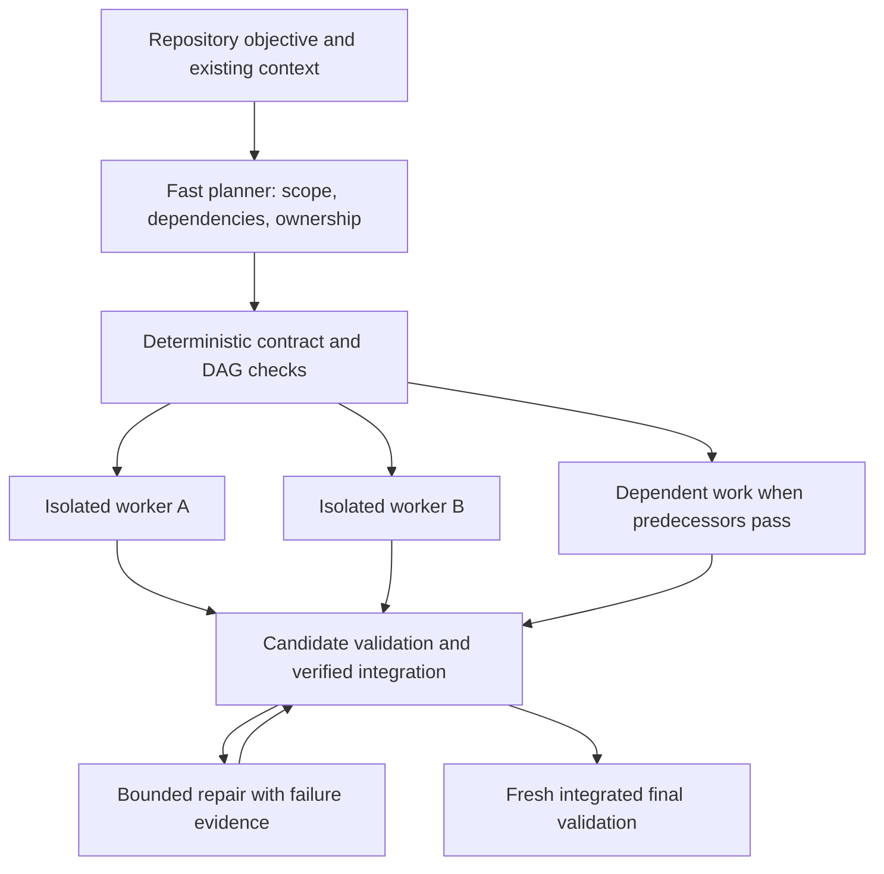
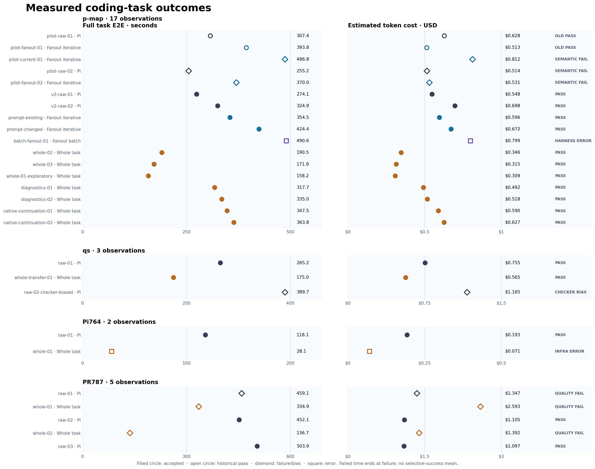

# When can parallel coding agents make slow inference useful?

**Fanout research preview · 16 September 2026**

Fanout investigates whether parallel execution can make high-latency, low-cost inference competitive with ordinary realtime coding agents. The architecture combines a fast coordinator, bounded independent work, isolated workers, local validation and bounded repair.

The study identifies a meaningful **modeled feasibility region**: enough independent work can amortize coordination and overlap latency, while inexpensive capable workers can reduce total cost. Experiments quantify the bottlenecks that constrain that region. Repeated success across concrete tasks, models and provider services remains incomplete. The parallel thesis is neither a universal speed guarantee nor disproven by a narrow task where coordination loses.

This report presents the architecture, measured experiments and a declared sensitivity model. It publishes curated summaries rather than raw sessions or execution traces. [Summary data and figure reproduction](study/README.md) describe what can be independently reproduced.

## Architecture and comparison framework

The core workflow is:



The diagram is schematic, not a recorded run. Actual edges follow repository dependencies; a shared interface or inseparable runtime/test repair can reduce available parallelism. Rejected work still consumes time and money. Fanout's [local trust boundary](adr/0001-inherit-pi-local-trust.md) preserves the user's normal Pi permissions; isolated Git reconstructions are not security sandboxes for hostile code.

The study's backbone is a four-workflow comparison, with task, acceptance and model roles stated for each result:

| Workflow | Service | Question it helps answer |
| --- | --- | --- |
| Ordinary Pi | Realtime | What does correct completion cost without Fanout? |
| Ordinary Pi | Async | What does the slower service change in the ordinary agent loop? |
| Parallel Fanout | Realtime workers | Does parallelism repay planning, context and integration overhead? |
| Parallel Fanout | Async workers, declared fast planning/repair | Can parallelism retain the cheap service's advantage at acceptable completion time? |

Ordinary realtime Pi versus async Fanout changes both orchestration and service; model changes also change capability and pricing. A product comparison can still inform a user, but it does not isolate any one mechanism. The full matched four-workflow matrix has not been completed.

A **whole-task candidate** is a separate request-depth experiment: prepare existing sources, ask for a complete candidate, validate locally, then allow bounded fast repair. It tests what happens when initial provider calls are minimized. It is not the replacement Fanout architecture. Complete-candidate delivery can also be used inside individual parallel workers. Parallel decomposition and the number of turns per worker are independent choices.

## What makes the economics work?

For a fixed schedule, task completion time comprises coordination, the longest dependent execution path, and non-overlapping integration/final checks. Every sequential provider request on that path can add a slow-service latency payment. Parallel branches overlap time, while **all branches contribute cost**.

Useful conditions are therefore:

1. **Enough useful independent work.** Width must come from the task's requirements, not a desired worker count. More files do not necessarily mean more parallelism.
2. **A bounded critical path.** DAG depth counts dependent work stages; request depth counts sequential model calls within those stages. One node can make many requests.
3. **Sufficient worker throughput and quality.** Cheap inference must still produce complete, correct candidates. Better capability may reduce repairs, but its effect needs measurement.
4. **Affordable coordination and recovery.** Planning, duplicate context, validation, integration and every rejected attempt consume the savings margin.

One provider response per worker is not a universal prerequisite. Several responses can still win on sufficiently wide work. Conversely, a one-response candidate can be expensive if a fast model must finish most of it. Whole-task candidates also face context, output and reasoning limits; that is not a claim that an ordinary iterative single agent cannot handle large tasks.

## Measured experiments

The recent controlled screen used `openai-codex/gpt-5.6-sol` at medium reasoning for ordinary Pi, Fanout planning and fast repairs, and `openai-codex/gpt-5.6-terra` at medium reasoning for ordinary Fanout workers or whole-task initial candidates. Async was disabled in these comparisons. Fanout's realtime fallback assignment should not be mistaken for an earlier failed Sol attempt.

All dollar figures below are estimated token costs, not subscription billing or provider operating cost. Times are recorded task boundaries including planning where present, required gates, failed work and repair. Common preparation, initialization and later manual audits have cohort-specific exclusions described below. Do not pool different protocols into one savings average.



*Measured observations, not simulated provider performance. Failed or interrupted points show resources consumed, not time or cost to correct completion. Exact rows, model roles and qualifications are in the [curated data](study/README.md).*

### 1. Reduce parallel Fanout's coordination and request overhead

**Hypothesis.** Repeated planning, source discovery and avoidable scope errors consume the parallelism benefit.

**Intervention.** Combine planning and grounding into one model context; prepare bounded source context; reject unauthorized writes before they reach final integration; align validation with repair ownership. These are implemented product changes (`a7b5ef6`, `b6a6fab`).

**Observed outcome.** The initial p-map pilot changed Fanout from 486.832s / $0.8119022 to 393.781s / $0.5128764, versus ordinary Pi at 307.421s / $0.627699. Planning decreased from 146.604s to 89.811s. The original Fanout candidate failed a later semantic audit; improved Fanout and raw Pi passed that audit. The improved reverse-order repeat took 369.965s / $0.5307096 versus raw 255.175s / $0.514409, but both failed the stronger abort check.

**Limitation and decision.** These small, evolving experiments demonstrate overhead and acceptance problems, not a reliable speed gain or a controlled attribution to one change. The improved runtime worker still needed 13 and 17 sequential responses. The supplemental audit was outside historical E2E; later protocols included required independent acceptance. Retain the implementation, strengthen acceptance and investigate request depth. [Pilot](benchmarks/p-map-efficiency-pilot.md).

A subsequent complete-before-validation prompt pair passed stronger acceptance but made no demonstrated improvement: 354.484s / $0.596145 for the existing prompt versus 424.408s / $0.6720575 for the changed prompt. The changed prompt was not adopted. Moving validation later did not remove the long runtime chain. [Prompt experiment](BENCHMARKS.md#complete-before-validation-prompt-canary--2026-09-07).

### 2. Test complete candidates inside and outside Fanout

**Hypothesis.** Producing a substantial candidate before returning to the model can avoid serial slow requests.

**Intervention.** Use Pi's native edit/write batch and a benchmark-only termination rule, then apply local checks and bounded Sol repair. Test both parallel Fanout workers and a whole-task candidate without a planner.

**Observed outcome.** The exploratory whole-task run passed at 158.180s / $0.3086735. Two predeclared repeats passed at 190.539s / $0.346216 and 171.873s / $0.314870. Their mean, **181.206s / $0.330543**, was **39.50% faster and 46.92% cheaper** than the frozen two-run ordinary-Pi reference of 299.5145s / $0.622678. All three whole-task observations needed both allowed correction prompts.

The parallel candidate-batch arm consumed 490.575s / $0.7992885. Its final candidate passed native gates, but a reporting defect left the primary harness outcome **error**. A canonical prompt branch was also inactive despite the extension's batch instruction and termination being active. Both original workers reached the one-response target, followed by a nine-response Sol repair. Preserve the error status; do not credit the inactive prompt or call this a clean positive trial.

**Limitation and decision.** The whole-task result is a useful mechanism probe on a narrow task. Models, source preloading, tools, termination and recovery differ from ordinary Pi, so it is not an isolated batching effect or measured async gain. Explore transfer; retain parallel Fanout as the architecture and candidate delivery as an experimental worker strategy. [Batch evidence](BENCHMARKS.md#whole-task-batch-repeats-and-diagnostic-follow-up--2026-09-07).

### 3. Expose repair work and continuation costs

**Hypothesis.** More complete diagnostics, or allowing the cheap model to continue normally, might displace expensive repair.

**Observed outcome.** The complete-diagnostics pair passed but averaged 326.352s / $0.5050845, slower than raw Pi. Both initial candidates omitted required supporting artifacts. Normal Terra continuation passed at a mean of 355.666s / $0.60843225: 18.75% slower than raw for 2.29% lower estimated cost. Initial Terra chains used 8 and 13 responses and still required semantic repair.

**Decision.** These configurations did not improve the intended p-map latency tradeoff. The specific continuation configuration was rejected for this target. That result does not rule out multi-turn workers on wider tasks. Stronger completion gates were retained; further p-map variants are outside this release. [Diagnostics](BENCHMARKS.md#complete-diagnostics-whole-task-canary--2026-09-07), [continuation](BENCHMARKS.md#native-pi-continuation-decision--2026-09-07).

### 4. Transfer the fixed whole-task configuration

| Task | Observed outcome | Interpretation |
| --- | --- | --- |
| qs strict merge | Batch 174.992s / $0.564940; valid raw reference 265.166s / $0.754926; both pass | 34.01% faster and 25.17% cheaper in one transfer; repeatability unmeasured |
| Pi narrow rendering fix | Raw passed at 118.149s / $0.192988; batch stopped at 28.118s / $0.0709225 during repair | Provider usage-limit interruption; comparison incomplete, remaining trials unrun |
| Pi shared tree-navigation contract | Manual review accepted raw 2/3, batch 0/2 despite all final automated gates passing | No admitted arm mean; faster failed candidates are not completion wins |

The qs raw pair's second observation incurred unnecessary repair because a checker falsely rejected an unchanged surrounding call. Its cost remains recorded, but the biased pair mean is excluded as a fair control. The transfer used a corrected checker, also verified offline on the valid raw candidate; its changed timing boundary is disclosed.

For tree navigation, accepted raw points were 452.063s / $1.105290 and 503.870s / $1.097025. Failed batches cost $2.593488 and $1.392048. One spent **84.22% of estimated cost on Sol repairs**; the other needed two sequential initial Terra responses. Manual review found public-scope and documentation defects that automated gates missed. Large retained context and recovery demand motivate a fresh repair-session experiment, but they have not been isolated causally.

The fresh-repair prototype and acceptance changes passed offline checks. Its first live cohort stopped on network failure before edits, and a second frozen cohort was never launched after approval rejection. This is neither a model-quality failure nor evidence of repair savings. No new experiment is required for the research preview. [qs](BENCHMARKS.md#fixed-qs-complete-edit-batch-transfer--2026-09-07), [rendering](BENCHMARKS.md#pi-fixed-comparison-stopped-by-provider-usage-limit--2026-09-08), [tree navigation](BENCHMARKS.md#pr787-fixed-comparison-faster-traces-no-accepted-batch--2026-09-08).

## Modeled feasibility: overlap versus overhead

The following deliberately simple model explores conditions; it does not extrapolate the whole-task observations into Fanout speedups or predict model quality.


*Hypothetical equal-work sensitivity. Declared timing inputs from the earlier visualization example set an illustrative scale; they do not reconstruct a measured run, and the serial curve is not a measured ordinary-Pi baseline. All scenarios assume correct candidates, identical independent units and no repair. Price/work ratios are assumptions, not current provider quotes.*

For `D` synchronized dependent layers, `W` independent units per layer and concurrency `C`:

```text
N             = D × W
waves         = D × ceil(W / C)
T_serial      = V + E × N
T_fanout      = P + V + (E + r × L) × waves + R
```

`E` is the assumed realtime work envelope per unit; `r` is sequential slow requests per unit; `L` is **additional delay per request**, not total TTFT; `P` is extra Fanout planning; `V` is shared final validation; `R` is additional non-overlapping repair overhead. The displayed model sets `R = 0`. It assumes equal work and worker envelope in both configurations, enough independent work, fixed phase costs and synchronized homogeneous waves. Real staggered schedules need recorded dependencies and timing, not this shortcut.

The time scale uses `P = 307.086s`, `V = 296.075s`, `E = 279.310s`, `D = 2` and `C = 4`. These are declared model inputs, not a reconstructed measured baseline. The [input provenance table](study/README.md#timing-input-provenance) identifies the validation-time source and the unrecovered original planning/work-envelope derivations; those two values are used only as assumptions. Varying width changes total work in **both** configurations. The figure includes one and four sequential requests per worker with 60 seconds of added delay per request. Multi-turn workers can still enter the modeled winning region as useful width increases.

For the separate earlier modeled **Fanout-versus-Fanout** example, `D=2`, `W=3`, `C=4` gives `P + V + E × 2 = 1161.781s`. Two affected execution waves add `2 × 60 = 120s`, yielding `1281.781s`, or 10.33% more time. Adding six delays serially was incorrect because concurrent delays overlap. This calculation assumes one affected request per node; more sequential requests require additional delay payments. It is not a comparison with ordinary Pi.

The accompanying cost illustration assumes $0.30 per serial work unit, candidate unit-cost ratios of 0.5 and 0.8, and $0.35 fixed Fanout coordination/recovery cost. Cost sums **every unit**, not just execution waves. The illustration deliberately separates price assumptions from timing and shows why parallel speed does not itself imply savings. Real repairs consume both margins, and a more capable model's quality cannot be obtained by changing this ratio.

Provider continuation grouping, cache reuse and priority scheduling are separate hypotheses. This release does not simulate arbitrary adjacent requests as guaranteed cache hits or continuation groups. Historical prices remain historical; a new provider comparison must declare its actual service, measured completion availability and price snapshot.

## Methodology and reproducibility

A comparable experiment freezes task/base revision, independent acceptance, allowed writes, models and reasoning, service routing, dependencies, SDK/CLI versions, budgets, repetition order and stop rule before execution. Independent checks must reject known incorrect candidates and accept legitimate alternatives. Generated tests supplement those checks; manual public-contract and documentation review can still change the final quality outcome.

The stronger task clock begins before the first task-model request, including Fanout planning or whole-task source assembly. It includes required gates, all failed work, corrections, integration and cleanup. Common preprovisioning and initial SDK setup are separately reported. Later manual audits qualify quality but are outside the recorded automated clock; initial p-map supplemental audits were also outside E2E. These exclusions preclude a blanket claim of measured cold-start or human-reviewed completion time.

Report every attempted observation. Failed runs keep their resource costs; infrastructure stops remain distinct; do not replace failures or average only selected successes. Reuse a frozen raw reference only while task, model, environment and acceptance boundary remain comparable. Two passes establish two observed completions, not a success rate or tail-latency guarantee. Missing metrics are unavailable, not zero.

Three evidence classes remain separate:

| Class | Can establish | Cannot establish |
| --- | --- | --- |
| Measured | Recorded outcome, cost estimate, timing and requests under the declared configuration | Another model's quality, future reliability or provider operating economics |
| Fixed-trace counterfactual | Changed timing/prices with the same observed work, repairs and outcome | How an agent adapts its requests or makes different mistakes |
| Hypothetical design/model | Required conditions and sensitivity under explicit assumptions | Service guarantees or an observed winning task/model/provider combination |

The public [data guide](study/README.md) describes curated rows and figure regeneration. The [rerun methodology](study/METHODOLOGY.md) provides task pins, acceptance boundaries and available source tools. Raw logs, model conversations, prompts and recorded event streams are retained locally, not published. Public summaries cannot support independent replay of every historical measurement, and the ignored experimental drivers are not all packaged as turnkey reruns. A new run is new evidence, never a replacement for a frozen historical observation.

## What is built and what remains open

Implemented: combined planning and grounded contracts, DAG execution, repository profiles, isolated candidate work, typed ownership, bounded repair, exact patch/tree integration, event-derived observability, a local read-only profiler, and an independent Doubleword provider. See the [runtime guide](FANOUT_GUIDE.md) and [architecture](ARCHITECTURE.md).

The remaining research questions concern **where the conditions hold**, rather than whether a timing formula permits them:

- Which real tasks have enough useful width and volume to repay planning and integration?
- Which inexpensive worker models preserve quality with bounded request depth and repair?
- How does actual async completion availability behave under concurrency and load?
- Can continuation or caching policies improve responsiveness while preserving provider utilization and fairness?

Public tasks may be present in model training data, the Pi fixtures share a repository, acceptance is bounded, and useful task width remains unquantified. Historical Doubleword realtime microbenchmarks and attempted workflows do not complete the matched async coding-workflow matrix. The next empirical work should target these uncertainties with fixed comparisons. This release adds no router, orchestration layer, provider guarantee or product adoption of the whole-task prototype.
