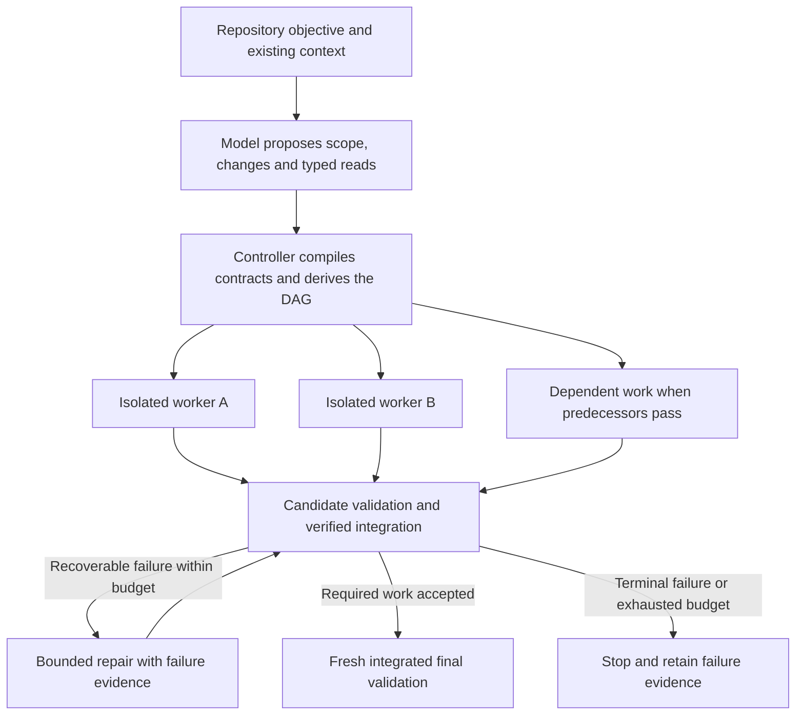
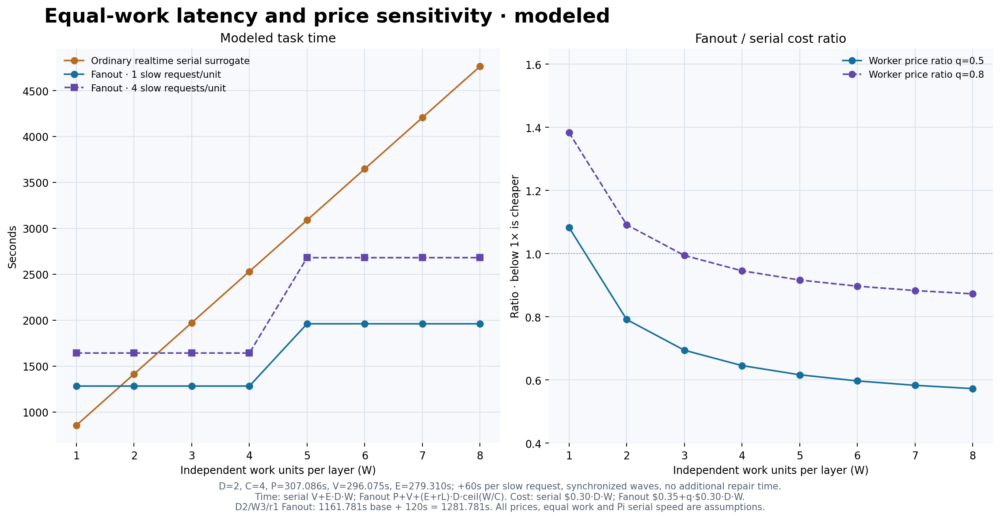

# When can parallel coding agents make slow inference useful?

**Fanout research preview · updated 17 September 2026**

Fanout investigates whether parallel execution can make high-latency, low-cost inference competitive with ordinary realtime coding agents. The result is an experimental Pi harness that compiles plans into bounded work, integrates isolated candidates, and records the time and cost of validation and recovery. Its development also exposed reusable design lessons about task decomposition, model context, feedback and repository state.

The study identifies a meaningful **modeled feasibility region**: enough independent work can amortize coordination and overlap latency, while inexpensive capable workers can reduce total cost. Experiments quantify the bottlenecks that constrain that region. Repeated success across concrete tasks, models and provider services remains incomplete. The parallel thesis is neither a universal speed guarantee nor disproven by a narrow task where coordination loses.

This report presents the architecture, measured experiments and a declared sensitivity model. It publishes curated summaries rather than raw sessions or execution traces. [Summary data and figure reproduction](study/README.md) describe what can be independently reproduced.

## How the investigation became Fanout

The June investigation began by asking whether existing interactive agent turns could be routed to cheaper, slower inference. Semantic review of ten recorded sessions found little work off the user-visible critical path: most turns supplied the next edit, tool call, check or answer. The larger estimated opportunities came from reducing redundant work and reorganizing execution. These were retrospective estimates under historical price and delay assumptions, with hindsight and prediction limits; they did not demonstrate live speedups or executable correctness.

That motivated planned parallel work: a fast coordinator establishes scope and dependencies, then workers execute independent units for validated integration. It also separated provider-independent improvements, such as fewer redundant turns, from savings attributable to a cheaper service. [Early analysis](benchmarks/semantic-dag-and-rpe.md#method-correction), [evaluation limits](benchmarks/safe-work-unit-eval-protocol.md).

## Architecture and comparison framework

The core workflow is:



The diagram is schematic, not a recorded run. Actual edges follow repository dependencies; a shared interface or inseparable runtime/test repair can reduce available parallelism. Rejected work still consumes time and money. Fanout's [local trust boundary](adr/0001-inherit-pi-local-trust.md) preserves the user's normal Pi permissions; isolated Git reconstructions are not security sandboxes for hostile code.

Models supply semantic judgment; deterministic contracts govern execution. One canonical work contract supplies write authority, typed reads, validation and worker context, from which code derives scheduling and human-readable views. This boundary addresses a concrete early failure: a retrospective evaluation accepted individual units as safe after dependencies even though their combined graph contained a cycle. Unit-level judgments need whole-graph checks before workers launch. [Compiler rationale](DESIGN_DECISIONS.md#compiler-owns-execution-dag-construction), [cyclic prediction](DESIGN_DECISIONS.md#scheduler-must-reject-cycles-and-ownership-conflicts-before-tier2-launch).

The study's backbone is a four-workflow comparison, with task, acceptance and model roles stated for each result:

| Workflow | Service | Question it helps answer |
| --- | --- | --- |
| Ordinary Pi | Realtime | What does correct completion cost without Fanout? |
| Ordinary Pi | Async | What does the slower service change in the ordinary agent loop? |
| Parallel Fanout | Realtime workers | Does parallelism repay planning, context and integration overhead? |
| Parallel Fanout | Async workers, declared fast planning/repair | Can parallelism retain the cheap service's advantage at acceptable completion time? |

Ordinary realtime Pi versus async Fanout changes both orchestration and service; model changes also change capability and pricing. A product comparison can still inform a user, but it does not isolate any one mechanism. The full matched four-workflow matrix has not been completed.

Model role and service tier are separate choices. Fanout can keep a strong realtime coordinator while assigning a different model to async execution or realtime worker fallback. A packet freezes those assignments, so a run's policy does not drift when settings change. This supports experiments with ordinary workers and fast repairs without requiring every realtime call to use the coordinator's model. [Role separation](DESIGN_DECISIONS.md#separate-the-tier-2-fallback-model-role-from-tier-1).

A **whole-task candidate** is a separate request-depth experiment: prepare existing sources, ask for a complete candidate, validate locally, then allow bounded fast repair. It tests what happens when initial provider calls are minimized. It is not the replacement Fanout architecture. Complete-candidate delivery can also be used inside individual parallel workers. Parallel decomposition and the number of turns per worker are independent choices.

## What makes the economics work?

For a fixed schedule, task completion time comprises coordination, the longest dependent execution path, and non-overlapping integration/final checks. Every sequential provider request on that path can add a slow-service latency payment. Parallel branches overlap time, while **all branches contribute cost**.

Useful conditions are therefore:

1. **Enough useful independent work.** Width must come from the task's requirements, not a desired worker count. More files do not necessarily mean more parallelism.
2. **A bounded critical path.** DAG depth counts dependent work stages; request depth counts sequential model calls within those stages. One node can make many requests.
3. **Sufficient worker throughput and quality.** Cheap inference must still produce complete, correct candidates. Better capability may reduce repairs, but its effect needs measurement.
4. **Affordable coordination and recovery.** Planning, duplicate context, validation, integration and every rejected attempt consume the savings margin.

One provider response per worker is not a universal prerequisite. Several responses can still win on sufficiently wide work. Conversely, a one-response candidate can be expensive if a fast model must finish most of it. Whole-task candidates also face context, output and reasoning limits; that is not a claim that an ordinary iterative single agent cannot handle large tasks.

## Measured experiments

All dollar figures below are estimated token costs, not subscription billing or provider operating cost. Timing boundaries differ by cohort: the historical Execa repetitions measure live execution after planning, while the recent workflow comparisons include planning where present, required gates, failed work and repair. Common preparation, initialization and later manual audits have cohort-specific exclusions. Do not pool different protocols into one savings average.

| Question | Intervention | Observation and resulting lesson |
| --- | --- | --- |
| Can parallel work be integrated reliably within a fixed configuration? | Isolated Execa workers, exact candidate checks and bounded recovery | Five historical runs completed; overlap and integration worked, while repairs and long gates remained substantial. |
| Can coordination overhead be reduced? | Combined planning and prepared worker sources | The p-map pilot improved, but long sequential worker chains still constrained completion time. |
| Can complete candidates reduce request depth? | Experimental initial edit batches, inside and outside Fanout | Narrow-task whole-candidate wins were possible; fast-model correction remained part of every p-map batch result. |
| Does the whole-task result transfer? | Fixed configuration on qs and two Pi tasks | One positive qs observation, one interrupted comparison and shared-contract quality failures exposed the limits. |

### Historical parallel execution: Execa

On 5 August, five fixed-packet repetitions implemented Execa Web Stream conversion with concurrency four: runtime plus behavioral tests, types plus type tests, and two documentation units. Routing used GPT-5.6 Sol medium for control and fast repair, and GPT-5.6 Terra medium for realtime workers; async was disabled. All five runs completed and passed controller final validation and separate full-suite reruns.

| Repetition | Live execution | Estimated execution cost | Recovery |
| --- | ---: | ---: | --- |
| 1 | 631.296s | $0.5685264 | None |
| 2 | 964.733s | $0.8108926 | One final repair |
| 3 | 1,011.988s | $0.9649424 | One final repair |
| 4 | 1,530.488s | $1.1499204 | One clean runtime retry and one final repair |
| 5 | 995.074s | $0.8866022 | One final repair |

Median live execution was **995.074s**, with median estimated execution cost **$0.8866022**. The recorded original-worker overlap metric had a median of **200.798s**; this describes overlap within runs, not a measured speedup against an ordinary Pi baseline. Fourteen deterministic reconciliations integrated disjoint candidates onto advancing accepted trees across the cohort. These observations establish working parallel execution, integration and bounded recovery for the frozen configuration.

Planning time and cost are excluded from this table. The fixture had native tests and independent reruns, but no common independently authored semantic acceptance suite. The 5/5 observation does not establish current-runtime reliability or an end-to-end cost/time advantage. An earlier, separately configured Execa comparison favored ordinary Pi on both full task time and total cost; it is not a matched control for these five repetitions. [Cohort and source identities](benchmarks/execa-web-streams-manual-e2e.md#2026-08-05-five-repetition-cohort), [earlier ordinary-Pi comparison](benchmarks/execa-web-streams-manual-e2e.md#observed-comparison-with-the-recovery-policy-fanout-canary).

The following September comparisons used `openai-codex/gpt-5.6-sol` at medium reasoning for ordinary Pi, Fanout planning and fast repairs, and `openai-codex/gpt-5.6-terra` at medium reasoning for ordinary Fanout workers or whole-task initial candidates. Async was disabled. Fanout's realtime fallback assignment should not be mistaken for an earlier failed Sol attempt. The [full per-run figure](study/README.md#measured-workflow-figure) presents all 27 selected recent observations, including failures and interruptions; the historical Execa cohort remains separate.

### 1. Reduce parallel Fanout's coordination and request overhead

**Hypothesis.** Repeated planning, source discovery and avoidable scope errors consume the parallelism benefit.

**Intervention.** Combine planning and grounding into one model context; prepare bounded source context; reject unauthorized writes before they reach final integration; align validation with repair ownership. These are implemented product changes (`a7b5ef6`, `b6a6fab`).

**Observed outcome.** The initial p-map pilot changed Fanout from 486.832s / $0.8119022 to 393.781s / $0.5128764, versus ordinary Pi at 307.421s / $0.627699. Planning decreased from 146.604s to 89.811s. The original Fanout candidate failed a later semantic audit; improved Fanout and raw Pi passed that audit. The improved reverse-order repeat took 369.965s / $0.5307096 versus raw 255.175s / $0.514409, but both failed the stronger abort check.

**Limitation and decision.** These small, evolving experiments demonstrate overhead and acceptance problems, not a reliable speed gain or a controlled attribution to one change. The improved runtime worker still needed 13 and 17 sequential responses. The supplemental audit was outside historical E2E; later protocols included required independent acceptance. Retain the implementation, strengthen acceptance and investigate request depth. [Pilot](benchmarks/p-map-efficiency-pilot.md).

A subsequent complete-before-validation prompt pair passed stronger acceptance but made no demonstrated improvement: 354.484s / $0.596145 for the existing prompt versus 424.408s / $0.6720575 for the changed prompt. The changed prompt was not adopted. Moving validation later did not remove the long runtime chain. [Prompt experiment](BENCHMARKS.md#complete-before-validation-prompt-canary--2026-09-07).

### 2. Test complete candidates inside and outside Fanout

**Hypothesis.** Producing a substantial candidate before returning to the model can avoid serial slow requests.

**Intervention.** Use Pi's native edit/write batch and a benchmark-only termination rule, then apply local checks and bounded Sol repair. Test both parallel Fanout workers and a whole-task candidate without a planner.

**Observed outcome.** The exploratory whole-task run passed at 158.180s / $0.3086735. Two predeclared repeats passed at 190.539s / $0.346216 and 171.873s / $0.314870. Their mean, **181.206s / $0.330543**, was **39.50% faster and 46.92% cheaper** than the frozen two-run ordinary-Pi reference of 299.5145s / $0.622678. All three whole-task observations needed both allowed correction prompts.

The parallel candidate-batch arm consumed 490.575s / $0.7992885. Its final candidate passed native gates, but a reporting defect left the primary harness outcome **error**. A canonical prompt branch was also inactive despite the extension's batch instruction and termination being active. Both original workers reached the one-response target, followed by a nine-response Sol repair. Preserve the error status; do not credit the inactive prompt or call this a clean positive trial.

**Limitation and decision.** The whole-task result is a useful mechanism probe on a narrow task. Models, source preloading, tools, termination and recovery differ from ordinary Pi, so it is not an isolated batching effect or measured async gain. Explore transfer; retain parallel Fanout as the architecture and candidate delivery as an experimental worker strategy. [Batch evidence](BENCHMARKS.md#whole-task-batch-repeats-and-diagnostic-follow-up--2026-09-07).

### 3. Expose repair work and continuation costs

**Hypothesis.** More complete diagnostics, or allowing the cheap model to continue normally, might displace expensive repair.

**Observed outcome.** The complete-diagnostics pair passed but averaged 326.352s / $0.5050845, slower than raw Pi. Both initial candidates omitted required supporting artifacts. Normal Terra continuation passed at a mean of 355.666s / $0.60843225: 18.75% slower than raw for 2.29% lower estimated cost. Initial Terra chains used 8 and 13 responses and still required semantic repair.

**Decision.** These configurations did not improve the intended p-map latency tradeoff. The specific continuation configuration was rejected for this target. That result does not rule out multi-turn workers on wider tasks. Stronger completion gates were retained; further p-map variants are outside this release. [Diagnostics](BENCHMARKS.md#complete-diagnostics-whole-task-canary--2026-09-07), [continuation](BENCHMARKS.md#native-pi-continuation-decision--2026-09-07).

### 4. Transfer the fixed whole-task configuration

| Task | Observed outcome | Interpretation |
| --- | --- | --- |
| qs strict merge | Batch 174.992s / $0.564940; valid raw reference 265.166s / $0.754926; both pass | 34.01% faster and 25.17% cheaper in one transfer; repeatability unmeasured |
| Pi narrow rendering fix | Raw passed at 118.149s / $0.192988; batch stopped at 28.118s / $0.0709225 during repair | Provider usage-limit interruption; comparison incomplete, remaining trials unrun |
| Pi shared tree-navigation contract | Manual review accepted raw 2/3, batch 0/2 despite all final automated gates passing | No admitted arm mean; faster failed candidates are not completion wins |

The qs raw pair's second observation incurred unnecessary repair because a checker falsely rejected an unchanged surrounding call. Its cost remains recorded, but the biased pair mean is excluded as a fair control. The transfer used a corrected checker, also verified offline on the valid raw candidate; its changed timing boundary is disclosed.

For tree navigation, accepted raw points were 452.063s / $1.105290 and 503.870s / $1.097025. Failed batches cost $2.593488 and $1.392048. One spent **84.22% of estimated cost on Sol repairs**; the other needed two sequential initial Terra responses. Manual review found public-scope and documentation defects that automated gates missed. Large retained context and recovery demand motivate a fresh repair-session experiment, but they have not been isolated causally.

The fresh-repair prototype and acceptance changes passed offline checks, but live evaluation stopped before edits on a network failure and a later cohort was not launched. Repair savings therefore remain unmeasured; the detailed record preserves both stops. [qs](BENCHMARKS.md#fixed-qs-complete-edit-batch-transfer--2026-09-07), [rendering](BENCHMARKS.md#pi-fixed-comparison-stopped-by-provider-usage-limit--2026-09-08), [tree navigation](BENCHMARKS.md#pr787-fixed-comparison-faster-traces-no-accepted-batch--2026-09-08).

### Provider calibration: latency depends on workload

The 30 August Doubleword realtime microbenchmarks measured 200 short-prompt calls, 50 per model, followed by 20 long-context calls, five per model. Short-prompt median visible-text TTFT ranged from 0.715s to 5.237s across the four models. The identical long prompt tokenized to roughly 96,000–144,000 input tokens depending on model; long-context median TTFT ranged from 4.594s to 8.500s. All calls returned the required exact short answer. The five-call samples do not establish stable tail latency.

The benchmark distinguishes response headers, first streaming event, first visible output text and total completion. These are sequential endpoint probes, excluding Pi startup and coding work. They show why latency calibration must name the model, workload and measurement boundary; they cannot establish coding quality, concurrent behavior or async completion availability. Requested priority service also differed from the streamed tier label, with sampled response retrievals reporting priority. [Settings, per-model results and tier caveat](BENCHMARKS.md#l1--realtime-doubleword-ttft-microbenchmark).

## Lessons from building the harness

### Decompose around repair ownership

Planning rules can hide or manufacture apparent parallelism. On the same Execa task, three successive prompt variants produced one item owning all 14 paths, five items with runtime dependencies, then three concurrently ready repair boundaries: runtime and behavioral tests, types and type tests, and documentation. Requiring every item to be independently releasable had collapsed useful width; splitting runtime resources too finely assigned workers checks whose failures could require repairs outside their ownership.

The resulting rule is to keep repair-coupled production and tests together while allowing independently authorable work to proceed in parallel. A dependency edge supplies ordering and accepted output; it does not grant authority to repair a predecessor. Independence alone also does not justify another worker: useful work must repay setup, context and validation costs. Current planning guidance weighs that tradeoff without an unmeasured numeric threshold. The comparison above generated planning artifacts only, so it demonstrates changed decomposition, not execution quality or a measured speed gain. [Planning comparison](benchmarks/execa-web-streams-manual-e2e.md#2026-08-30-planning-parallelism-prompt-check), [granularity decision](impl/fanout-audit-progress.md#f16--independence-alone-does-not-justify-another-worker).

### Separate artifact structure from model context

Plan and grounding are different responsibilities, but they need not require separate repository investigations. Combined planning keeps their distinct persisted artifacts and deterministic checks while sharing one model context. The p-map pilot reduced planning from 146.604s to 89.811s as part of a broader intervention; it does not isolate this change's effect. Human-facing reports use a separate display path that adds no provider messages, avoiding repeated ingestion of material intended for the user. These choices preserve reviewable structure while controlling the work presented to models. [Planning decision](DESIGN_DECISIONS.md#optimize-sequential-provider-requests-with-combined-planning-and-prepared-workers), [report-context boundary](research/pi-report-context-boundary.md).

### Give validation explicit scope and ownership

Early p-map attempts 11 and 12 reached four successful work nodes, then exhausted final repairs on deterministic formatting. An offline reconstruction of attempt 11 passed all **55 tests** after the repository's fixer ran once. Explicit normalization moved that work into the controller; repository profiles now own it. This is evidence of an avoidable failure mode, not a measured live speedup. [Normalization origin](DESIGN_DECISIONS.md#normalize-candidates-only-through-packet-declared-commands).

Restricting workers also removed feedback they needed. Controller-only checks converted locally correctable failures into separate repair attempts. The immutable `fanout_validate` tool restored focused feedback while leaving acceptance to the controller. Its scope then needed refinement: in the corrected Execa canary, a final-repair worker ran focused lint plus the full suite in **300.326s**, followed by **300.091s** for the same gates in the controller. Required project-wide gates now remain controller-owned. [Feedback decision](DESIGN_DECISIONS.md#let-workers-run-only-their-immutable-contract-validation), [observed duplication](benchmarks/execa-web-streams-manual-e2e.md#2026-08-05-corrected-packet-v9-worker-validation-canary), [scope refinement](DESIGN_DECISIONS.md#keep-project-final-gates-controller-only-during-final-repair).

Repair must target the layer that failed. Editing application code cannot fix a malformed frozen validation command; that contract needs correction through planning. Scope diagnostic checks to the worker, preserve final acceptance, and count every validation round. [Command-grounding lesson](impl/fanout-audit-progress.md#f10--frozen-invalid-commands-cannot-be-repaired-by-editing-code).

### Avoid repair work created by the harness

Repair economics depend on orchestration as well as model capability. Reconstructing every repair from the accepted tree discarded previous rejected corrections. Cumulative repair seeds now preserve that work without treating it as accepted. A candidate based on an older accepted tree can be reconciled deterministically when its changed paths are disjoint from intervening accepted changes; ownership, normalization and validation still apply. Exact repetition of both candidate and failure state ends a no-progress repair chain within the fixed budget.

Validation must also refer to the exact candidate returned to the repository. Commands can modify files: passing tests on a changed tree would not justify applying the patch captured before those tests. Fanout verifies candidate identity after validation and reconstructs final checks from accepted transitions. Retry and repair allocations consume fixed node-wide budgets before launch, so nested recovery cannot reset its allowance. These bound attempts rather than guaranteeing a dollar cost or the same number of model responses per attempt. [Exact candidate check](DESIGN_DECISIONS.md#require-node-validation-to-preserve-the-captured-patch), [recovery budgets](adr/0005-route-attempts-from-typed-facts-and-fixed-budgets.md).

These mechanisms are implemented, and the Execa cohort exercised deterministic reconciliation. Their individual cost/time effects were not isolated experimentally. More capable inexpensive workers may reduce semantic repair demand, while the harness must avoid discarding progress or spending model calls on deterministic bookkeeping. [Repair continuity](DESIGN_DECISIONS.md#preserve-rejected-repair-candidates-cumulatively), [disjoint reconciliation](DESIGN_DECISIONS.md#reconcile-only-exact-path-disjoint-stale-candidates), [no-progress termination](DESIGN_DECISIONS.md#stop-repairs-on-exact-repeated-state).

## Modeled feasibility: overlap versus overhead

The following deliberately simple model explores conditions; it does not extrapolate the whole-task observations into Fanout speedups or predict model quality.



*Hypothetical equal-work sensitivity. Declared timing inputs from the earlier visualization example set an illustrative scale; they do not reconstruct a measured run, and the serial curve is not a measured ordinary-Pi baseline. All scenarios assume correct candidates, identical independent units and no repair. Price/work ratios are assumptions, not current provider quotes.*

For `D` synchronized dependent layers, `W` independent units per layer and concurrency `C`:

```text
N             = D × W
waves         = D × ceil(W / C)
T_serial      = V + E × N
T_fanout      = P + V + (E + r × L) × waves + R
```

`E` is the assumed realtime work envelope per unit; `r` is sequential slow requests per unit; `L` is **additional delay per request**, not total TTFT; `P` is extra Fanout planning; `V` is shared final validation; `R` is additional non-overlapping repair overhead. The displayed model sets `R = 0`. It assumes equal work and worker envelope in both configurations, enough independent work, fixed phase costs and synchronized homogeneous waves. Real staggered schedules need recorded dependencies and timing, not this shortcut.

The time scale uses `P = 307.086s`, `V = 296.075s`, `E = 279.310s`, `D = 2` and `C = 4`. These are declared model inputs, not a reconstructed measured baseline. The [input provenance table](study/README.md#timing-input-provenance) identifies the validation-time source and the unrecovered original planning/work-envelope derivations; those two values are used only as assumptions. Varying width changes total work in **both** configurations. The figure includes one and four sequential requests per worker with 60 seconds of added delay per request. Multi-turn workers can still enter the modeled winning region as useful width increases.

For the separate earlier modeled **Fanout-versus-Fanout** example, `D=2`, `W=3`, `C=4` gives `P + V + E × 2 = 1161.781s`. Two affected execution waves add `2 × 60 = 120s`, yielding `1281.781s`, or 10.33% more time. Adding six delays serially was incorrect because concurrent delays overlap. This calculation assumes one affected request per node; more sequential requests require additional delay payments. It is not a comparison with ordinary Pi.

The accompanying cost illustration assumes $0.30 per serial work unit, candidate unit-cost ratios of 0.5 and 0.8, and $0.35 fixed Fanout coordination/recovery cost. Cost sums **every unit**, not just execution waves. The illustration deliberately separates price assumptions from timing and shows why parallel speed does not itself imply savings. Real repairs consume both margins, and a more capable model's quality cannot be obtained by changing this ratio.

The model also gives a recovery budget to test: additional non-overlapping repair time must stay below `T_serial - T_fanout(R=0)` to preserve a time advantage. A non-positive difference leaves no such margin. Additional repair spend must fit the modeled cost difference, counting only spend beyond the already included $0.35 allowance. Larger tasks can amortize fixed coordination, but per-worker sequential latency and finite concurrency remain. These are conditional break-even limits, not predictions of a model's repair demand.

Provider continuation grouping, cache reuse and priority scheduling are separate hypotheses. This release does not simulate arbitrary adjacent requests as guaranteed cache hits or continuation groups. Historical prices remain historical; a new provider comparison must declare its actual service, measured completion availability and price snapshot.

## Methodology and reproducibility

A comparable experiment freezes task/base revision, independent acceptance, allowed writes, models and reasoning, service routing, dependencies, SDK/CLI versions, budgets, repetition order and stop rule before execution. Independent checks must reject known incorrect candidates and accept legitimate alternatives. Generated tests supplement those checks; manual public-contract and documentation review can still change the final quality outcome.

The stronger task clock begins before the first task-model request, including Fanout planning or whole-task source assembly. It includes required gates, all failed work, corrections, integration and cleanup. Common preprovisioning and initial SDK setup are separately reported. Later manual audits qualify quality but are outside the recorded automated clock; initial p-map supplemental audits were also outside E2E. These exclusions preclude a blanket claim of measured cold-start or human-reviewed completion time.

Report every attempted observation. Failed runs keep their resource costs; infrastructure stops remain distinct; do not replace failures or average only selected successes. Reuse a frozen raw reference only while task, model, environment and acceptance boundary remain comparable. Two passes establish two observed completions, not a success rate or tail-latency guarantee. Missing metrics are unavailable, not zero.

Repository acceptance and measurement completeness are separate decisions. The harness permits valid partial measurements only with observed assignment identity and passing repository gates; malformed or contradictory evidence remains invalid. Such a candidate can be accepted while complete cost or timing comparisons remain unavailable. The cheap worker must also perform implementation reasoning: if an expensive planner has already solved the task and the worker only applies its answer, the experiment has not demonstrated inexpensive implementation. Account for all coordinator and repair work. [Measurement decision](adr/0005-route-attempts-from-typed-facts-and-fixed-budgets.md), [study principle](DESIGN_DECISIONS.md#evaluate-correct-completion-across-orchestration-and-provider-service).

Three evidence classes remain separate:

| Class | Can establish | Cannot establish |
| --- | --- | --- |
| Measured | Recorded outcome, cost estimate, timing and requests under the declared configuration | Another model's quality, future reliability or provider operating economics |
| Fixed-trace counterfactual | Changed timing/prices with the same observed work, repairs and outcome | How an agent adapts its requests or makes different mistakes |
| Hypothetical design/model | Required conditions and sensitivity under explicit assumptions | Service guarantees or an observed winning task/model/provider combination |

The public [data guide](study/README.md) describes curated rows and figure regeneration. The [rerun methodology](study/METHODOLOGY.md) provides task pins, acceptance boundaries and available source tools. Raw logs, model conversations, prompts and recorded event streams are retained locally, not published. Public summaries cannot support independent replay of every historical measurement, and the ignored experimental drivers are not all packaged as turnkey reruns. A new run is new evidence, never a replacement for a frozen historical observation.

## What is built and what remains open

The implementation offers three reusable capabilities:

- **Execute bounded parallel work.** The Pi adapter runs compiled work contracts with repository profiles, isolated candidates, exact integration and bounded recovery. The core owns provider-independent policy; Pi is the implemented agent adapter.
- **Investigate the economics.** The local read-only profiler derives views from execution events and can vary concurrency or provider timing/prices while holding recorded work, repairs and outcomes fixed. It answers scheduling questions without predicting another model's quality, and withholds unsupported alternatives when measurements are incomplete.
- **Use provider support independently.** Doubleword discovery, transport and pricing belong to a standalone provider. Fanout-specific routing metadata belongs to the Pi adapter, so provider users do not inherit the harness.

Concurrency scales with useful independent work up to the configured capacity. Accepted changes still integrate serially and final checks remain on the completion path. The current recorder atomically replaces its whole event log, a deliberate scaling ceiling retained until measured volume justifies more machinery. These are explicit design boundaries, not an unlimited-throughput claim. See the [runtime guide](FANOUT_GUIDE.md), [profiler scenarios](ARCHITECTURE.md#offline-profiler-scenarios), [package boundaries](ARCHITECTURE.md#package-boundaries), and [recorder tradeoff](impl/fanout-audit-progress.md#f26--whole-log-replacement-is-a-deliberate-scaling-ceiling).

The remaining research questions concern **where the conditions hold**, rather than whether a timing formula permits them:

- Which real tasks have enough useful width and volume to repay planning and integration?
- Which inexpensive worker models preserve quality with bounded request depth and repair?
- How does actual async completion availability behave under concurrency and load?
- Can continuation or caching policies improve responsiveness while preserving provider utilization and fairness?

Public tasks may be present in model training data, the Pi fixtures share a repository, acceptance is bounded, and useful task width remains unquantified. Historical Doubleword realtime microbenchmarks and attempted workflows do not complete the matched async coding-workflow matrix. The next empirical work should target these uncertainties with fixed comparisons. This release adds no router, orchestration layer, provider guarantee or product adoption of the whole-task prototype.
