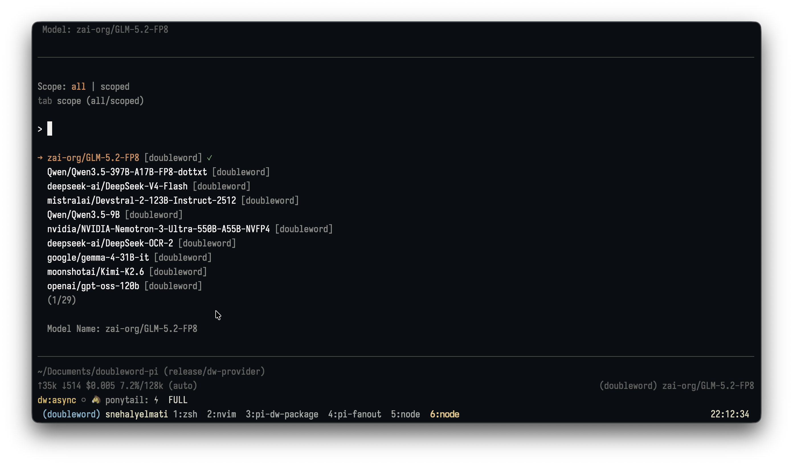

# Pi Doubleword Provider

Pi extension for the Doubleword realtime and async model provider.



[Doubleword](https://doubleword.ai) provides model inference with multiple execution tiers. This extension registers the live `doubleword` provider, discovers available models from Doubleword when an API key is present, and lets you toggle realtime vs async execution from inside Pi.

## Why Doubleword?

Doubleword's APIs are OpenAI-compatible and let you trade latency for lower cost:

- **Realtime / priority**: immediate responses for interactive coding.
- **Async / flex**: reduced pricing with background polling; Doubleword docs say submitted async work starts within about a minute.
- **Batch**: lowest pricing for bulk jobs with a 24h SLA.

Bundled [pricing snapshot](src/pricing.ts) (retrieved 2026-09-20), USD per 1M input/cache-read/output tokens. These rates support token-price estimates, not invoice totals.

| Model (catalog ID) | Realtime | Async | Batch |
| --- | --- | --- | --- |
| Kimi K3 (`moonshotai/kimi-k3`) | $3.00 / $0.30 / $15.00 | $2.15 / $0.22 / $11.25 | $1.50 / $0.15 / $7.50 |
| DeepSeek V4.1 Flash (`deepseek-ai/DeepSeek-V4.1-Flash`) | $0.15 / $0.01 / $0.60 | $0.12 / $0.01 / $0.48 | $0.08 / $0.01 / $0.30 |
| GLM-5.3 (`zai-org/GLM-5.3`) | $1.40 / $0.28 / $4.40 | $1.05 / $0.21 / $3.30 | $0.70 / $0.14 / $2.20 |
| DeepSeek V4 Flash 0731 (`deepseek-ai/DeepSeek-V4-Flash-0731`) | $0.09 / $0.02 / $0.18 | $0.07 / $0.01 / $0.14 | $0.05 / $0.01 / $0.09 |
| GLM 5.3 Flash (`zai-org/GLM-5.3-Flash`) | $0.15 / $0.03 / $0.50 | $0.11 / $0.02 / $0.38 | $0.08 / $0.02 / $0.25 |

Check current service terms and prices before a live run. Prices are synchronized manually from the [official model catalogue](https://docs.doubleword.ai/inference-api/models) into a reviewed snapshot; provider startup never scrapes pricing.

This provider exposes realtime and async in Pi; batch is better suited for offline evals and bulk jobs.

## Install

Requires **Pi 0.87.0 or newer**. Version 0.2.0 raises the minimum Pi version; upgrade Pi before installing it.

```bash
pi install npm:@snehalyelmati/pi-doubleword-provider
```

### 0.2.0 migration

Pi 0.86 moved system instructions and tools into transcript system messages. This release uses Pi's transcript helpers directly, fixing requests that silently omitted instructions and tools on newer Pi versions. Older Pi context formats are no longer supported. Realtime and async execution share the corrected serialization. No Fanout installation is required.

## Quick start

```bash
export DOUBLEWORD_API_KEY=...
pi --model doubleword/deepseek-ai/DeepSeek-V4-Flash-0731
```

Use `Alt+T` or `/doubleword-mode` to toggle realtime vs async execution for Doubleword models.

Supported Doubleword generation models use medium reasoning by default. Press `Shift+Tab` to change thinking depth or turn reasoning off; the provider sends the selected level to Doubleword as `reasoning.effort`.

## Configuration

Required for live models:

```text
DOUBLEWORD_API_KEY                 live API key
```

Optional overrides:

```text
DOUBLEWORD_BASE_URL                override API base URL
DOUBLEWORD_MODEL_CACHE_FILE        override cached /models catalog path
DOUBLEWORD_MAX_OUTPUT_TOKENS       override default 16384 output cap
DOUBLEWORD_LIVE_ASYNC_TIMEOUT_MS   override default 600000 async timeout
DOUBLEWORD_LIVE_ASYNC_POLL_MS      override default 2000 poll interval
DOUBLEWORD_CANCEL_TIMEOUT_MS       override default 10000 cancel request timeout
DOUBLEWORD_EXECUTION_MODE          realtime or async; defaults to realtime
```

## Capabilities

- Registers the live `doubleword` provider in Pi.
- Discovers models from Doubleword `/models` and caches the catalog locally.
- Falls back to a small known model list when discovery is unavailable.
- Supports realtime priority execution and async/flex background polling.
- Sends Doubleword Responses `reasoning.effort` for reasoning-capable models; OCR/embedding models are marked non-reasoning.
- Converts Doubleword reasoning output into Pi thinking blocks.
- Supports Responses function-call tool use.
- Reports native usage and exact pricing-snapshot provenance when returned by the provider.
- Best-effort cancels async background responses on timeout or user abort.

## Development

The repo contains a `doubleword-stub` provider for local smoke tests. It is enabled only by development entrypoints, not by the published standalone provider package.

From the repo root:

```bash
pi -e . --model doubleword-stub/deepseek-v4-flash
```

Run `npm run test:doubleword-provider` for offline request, usage, realtime, async, and planning regressions. The transport mocks load the standalone provider without Fanout. To check a release tarball, extract it and set `DOUBLEWORD_TEST_EXTENSION` to its absolute `package` directory when running `npm run smoke:live:realtime:mock`, `npm run smoke:live:async:mock`, and `node scripts/smoke-live-async-multiturn-mock.mjs` (with the local Pi binary on PATH). These tests use loopback servers, not paid endpoints.

## Limitations

- Live use requires a Doubleword API key.
- Async responses are delivered after polling completes; token streaming before completion is not assumed.
- The current Responses API path does not support prompt-cache writes. Nonzero cache-write usage has no trusted pricing provenance and is rejected by strict Fanout metrics admission.
